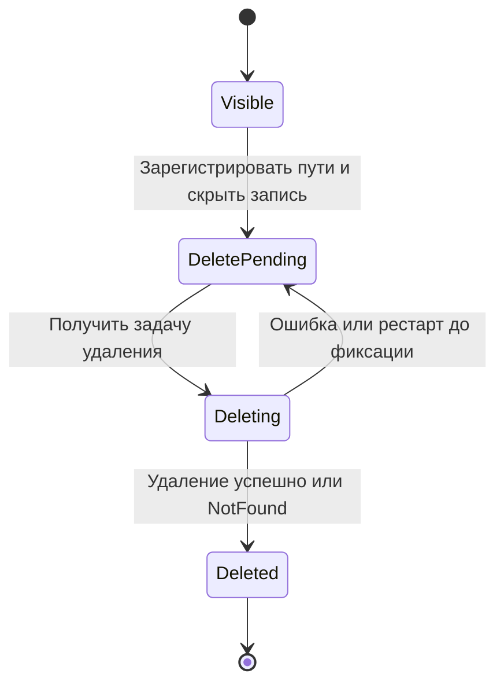
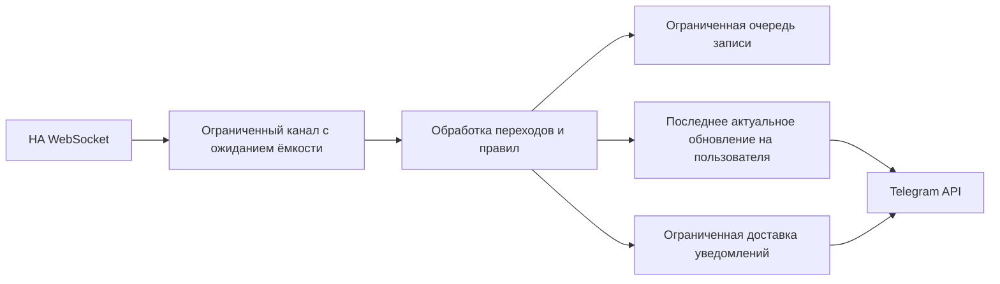

# Спецификация исправления багов общего ревью Telegram HA Bot

| Поле | Значение |
|---|---|
| Версия | 1.0 |
| Дата | 2026-09-30 |
| Базовая ревизия | `831d377` — `feat: implement bot UI/UX remediation` |
| Основание | 14 замечаний общего ревью приложения |
| Статус | Исправления реализованы; локальные проверки и открытые пункты приёмки — в [отчёте](IMPLEMENTATION.md) |
| Аудитория | Разработчик Rust, проверяющий изменения, QA, владелец установки |

## 1. Цель и область работ

Устранить восстановление удалённых пользователей, неявное закрепление прав,
раскрытие данных в группах, потери событий и видеозаписей, ошибки расписаний,
конкурентной работы с архивом, разбора команд и интерфейса.

Все BUG-01…BUG-14 являются **Must**. Приоритет **P1** задаёт первую очередь
исправления нарушений доступа и потери критичных событий/записей; **P2** —
следующую очередь. P2 не означает необязательность.

Решение остаётся одним приложением Rust/Tokio с SQLite, Telegram Bot API,
Home Assistant и LibAV. Новые сервисы, брокеры сообщений, веб-интерфейс,
миграция на другую БД и полная переработка архитектуры не требуются.

Документ дополняет, а не заменяет:

- [предыдущее устранение замечаний](../review-remediation/IMPLEMENTATION_PLAN.md);
- [контракт сохранения функций UI/UX](../ui-ux-remediation/README.md);
- [эксплуатационные требования](../operational-improvements/README.md).

Нумерация BUG соответствует порядку замечаний итогового общего ревью.
Ссылки на код обозначают исходную область изменения; после реализации строки
и распределение функций могут измениться.

## 2. Исходные данные и границы доказательств

При ревью базовой ревизии на локальном Rust 1.95 успешно выполнены
`cargo fmt --check`, `cargo check --locked --offline`,
`cargo clippy --locked --offline --all-targets -- -D warnings`,
`cargo test --locked --offline`: 260 тестов прошли, два теста с реальным HA
пропущены. Локальные HTTP/WebSocket-тесты запускались с разрешённым localhost.

Отдельно воспроизведены SQL-сценарии прав/удаления сегмента, разбор массовой
команды и panic при обрезке UTF-8. Остальные конкурентные сценарии установлены
анализом кода и должны получить регрессионные тесты при реализации.
Реальные Telegram, HA, RTSP и сборка Docker в рамках ревью не проверялись.
Эти результаты являются исходной точкой, а не приёмкой будущих исправлений.

## 3. Общие требования совместимости

- **INV-01.** Сохранить существующие комнаты, устройства, климат, графики,
  камеры, pre-roll, архив, группы действий, правила записи, расписания,
  избранное, личные настройки, подписки, языки ru/en и три voice engine.
- **INV-02.** Сохранить данные, идентификаторы, ручные алиасы, настройки,
  действующие файлы архива и работоспособность прежнего `options.json`.
  Новые необязательные настройки получают совместимые значения по умолчанию.
- **INV-03.** Не менять порядок и поля существующих вариантов callback enum,
  сериализуемых postcard/base64. Новые варианты добавлять в конец;
  старые callbacks и сохранённые контексты обрабатывать безопасно.
- **INV-04.** Обновление, навигация, повтор Telegram-запроса и восстановление
  экрана не выполняют физическое действие повторно. `for_refresh()` ведёт
  к чтению, а подтверждения сохраняют владельца, TTL и однократное потребление.
- **INV-05.** Каждый защищённый сценарий повторно проверяет актуального
  пользователя и права перед новой операцией. UI не служит границей доступа.
  Уже принятый внешней системой запрос невозможно отозвать локальным удалением.
- **INV-06.** Неопределённый результат внешнего действия отличается от отказа
  до отправки. Приложение не обещает выполнение «ровно один раз» между SQLite
  и HA и не повторяет действие автоматически после неопределённого результата.
- **INV-07.** Очереди и исполнители имеют конечные лимиты. Не заменять
  ограниченную очередь неограниченным `spawn` или накоплением в памяти.
- **INV-08.** Не держать транзакцию SQLite или блокировку общей структуры
  во время сетевого запроса, захвата видео или ожидания Telegram rate limit.
- **INV-09.** Исключения из прежнего поведения: защищённые действия доступны
  только в личном чате; удаление активной записи требует предварительной
  остановки; неоднозначная область команды не расширяется автоматически;
  период планирования и срок начала ожидающего запуска заданы FR-09.1/09.2.
  Остальные существующие сценарии сохраняются.

### 3.1. Термины и роли

| Термин | Значение |
|---|---|
| Допущенный пользователь | Существующий пользователь БД либо настроенный `root_user` |
| Администратор операции | Пользователь, которому текущий код разрешает эту административную операцию; исправления не расширяют круг таких пользователей |
| Наследуемое право | Значение из комнаты/профиля, не закреплённое отдельным разрешением устройства |
| Запуск расписания | Одно наступление времени конкретного расписания в серверной временной зоне |
| Отправлено | HA принял запрос; физический результат этим не подтверждён |
| Неопределённый результат | Запрос мог повлиять на HA, но подтверждённого результата нет |
| Логически удалённый архив | Не показывается пользователю, но его оставшиеся файлы ещё учитываются до физического удаления |

## 4. Реестр исправлений

| ID | Приоритет | Требуемый результат | Основные модули |
|---|---|---|---|
| BUG-01 | P1 | Завершение старой задачи не восстанавливает удалённого пользователя | [user](../../src/db/user.rs), [router](../../src/bot/router.rs), [UI](../../src/bot/handlers.rs), [sessions](../../src/core/mod.rs) |
| BUG-02 | P1 | Настройки уведомлений не закрепляют права устройства | [access](../../src/db/access.rs), [subscriptions](../../src/db/subscriptions.rs), [миграции](../../migrations) |
| BUG-03 | P1 | Защищённые данные и действия доступны только в личном чате | [schema](../../src/bot/mod.rs), [handlers](../../src/bot/handlers.rs) |
| BUG-04 | P1 | Ошибка/отмена чтения видео завершает реальную работу захвата | [cameras](../../src/core/cameras.rs), [pre-roll](../../src/core/camera_pre_roll.rs), [lockfile](../../Cargo.lock) |
| BUG-05 | P1 | Параллельные записи не теряются из-за конфликта лимитов | [recording](../../src/core/camera_recording.rs), [cameras](../../src/core/cameras.rs), [options](../../src/options.rs) |
| BUG-06 | P1 | Работа Telegram UI не блокирует приём и обработку HA-событий | [listener](../../src/ha/event_listener.rs), [processor](../../src/core/notification.rs), [main](../../src/main.rs) |
| BUG-07 | P2 | Область массовой команды не расширяется за пределы запроса | [commands](../../src/core/commands.rs), [подтверждения](../../src/bot/confirmations.rs) |
| BUG-08 | P2 | Перезапуск не повторяет уже начатый запуск расписания | [scheduler](../../src/core/action_schedules.rs), [schedule DB](../../src/db/action_groups.rs) |
| BUG-09 | P2 | Долгое выполнение не мешает постановке следующих расписаний | [scheduler](../../src/core/action_schedules.rs), [execution](../../src/core/action_groups.rs) |
| BUG-10 | P2 | Ошибки удаления файлов сохраняют их учёт и возможность повторения | [recording](../../src/core/camera_recording.rs), [segments](../../src/db/camera_recording_segments.rs), [sessions](../../src/db/camera_recording_sessions.rs) |
| BUG-11 | P2 | Удаление и публикация сегмента не создают неучтённый файл | [recording](../../src/core/camera_recording.rs), [camera UI](../../src/bot/screens/cameras.rs), [router](../../src/bot/router.rs) |
| BUG-12 | P2 | Параллельные отправки видео не изменяют файлы друг друга | [handlers](../../src/bot/handlers.rs), [compression](../../src/core/cameras.rs) |
| BUG-13 | P2 | Длинный ответ HA на любом языке не вызывает UTF-8 panic | [assist_pipeline](../../src/ha/assist_pipeline.rs) |
| BUG-14 | P2 | Переименование устройства работает и сохраняет ручное имя | [device settings](../../src/bot/screens/settings/device_settings.rs), [router](../../src/bot/router.rs), [devices](../../src/db/devices.rs) |

## 5. Требования и критерии приёмки

### BUG-01. Отзыв доступа и завершение старых UI-задач

**Причина.** Удаление пользователя не отменяет выполняющееся обновление UI.
Позднее сохранение сессии через UPSERT создаёт пользователя заново без прежних
ограничений. Удаление записи `ui_locks` не отзывает уже выданный `Arc` блокировки.

**FR-01.1.** Создавать строку `users` только в явном добавлении пользователя
администратором и отдельной инициализации настроенного `root_user`.
Сохранение сессии, языка и остальных настроек существующего пользователя
не должно создавать отсутствующего пользователя. Проверить все `INSERT/UPSERT`
в `users`, а не только `save_user_session`.

**FR-01.2.** Сохранение сессии возвращает различимый результат: сохранено,
пользователь отсутствует/отозван, ошибка БД. После отзыва памяти и БД нельзя
возвращать сессию, старый диалог или разрешение на основании прежнего контекста.

**FR-01.3.** Удаление согласовать с выполняющимися обновлениями, отменой,
очередями команд и обработчиками настроек. После commit удаления не начинать
новых защищённых операций этого пользователя. Повторное явное добавление
того же Telegram ID не позволяет старой задаче сохранить контекст новой сессии;
использовать поколение сессии/допуска либо эквивалентную проверку жизненного цикла.

**AC-01.** На барьере задержать ответ Telegram edit, удалить пользователя,
затем завершить edit: строки `users`, профиля, сессии и старого диалога не
восстанавливаются; следующий callback отклоняется. Повторить для смены языка,
ошибки/retry Telegram, перезапуска и удаления с последующим явным добавлением.
Первый `/start` root на пустой БД, запрет удаления root и обычное добавление
пользователя продолжают работать.

### BUG-02. Независимость уведомлений и прав управления

**Причина.** Переключение `can_notify` материализует права комнаты в
`user_device_access`. Последующая смена комнаты/роли перестаёт на них влиять.

**FR-02.1.** Выбранное решение: хранить административное разрешение уведомлений
отдельно от явных `can_view/can_control`. Персональная подписка остаётся отдельным
предпочтением пользователя и не отменяет административный запрет уведомлений.
Изменение уведомлений не создаёт, не удаляет и не переписывает device ACL.
Изменение ACL не сбрасывает настройки уведомлений. Конкурентные изменения
независимых полей не перезаписывают друг друга; переключение выполняется атомарно.

**FR-02.2.** Сохранить текущий приоритет явного device ACL над комнатой и ролью.
Реально выданное администратором разрешение устройства внутри закрытой комнаты
остаётся допустимым; настройки уведомлений не являются таким разрешением.
Доставка и сбор заголовков используют ту же итоговую политику видимости.

**FR-02.3.** Миграция переносит значения `can_notify` без потери подписок
и не сбрасывает массово прежние `can_view/can_control`. По старым строкам нельзя
достоверно отличить намеренное разрешение от скопированного при переключении
уведомлений. Для них подготовить перечень на проверку администратором:
пользователь, устройство, явное правило, наследуемое правило, итоговый доступ.
Предусмотреть явное действие «Наследовать права комнаты/профиля» для выбранной
записи без изменения настройки уведомлений.

**AC-02.** Без device override переключить уведомления, затем запретить
комнату: просмотр и управление закрываются. Для ограниченной роли после
переключения уведомлений выдать комнату: доступ появляется по наследованию.
Проверить намеренный device grant, его сброс к наследованию, отзыв комнаты,
перемещение устройства и административный запрет личной подписки. Сценарий
«уведомления выключены → изменение device ACL» сохраняет запрет уведомлений.
После миграции старые значения сохранены; неоднозначные записи присутствуют в перечне.
Закрытие риска старой установки требует проверки этого перечня владельцем.

### BUG-03. Ограничение защищённых сценариев личным чатом

**FR-03.1.** Общий входной фильтр до диалогов, обновления сессии, загрузки
данных HA и запуска медиа разрешает защищённые Message и CallbackQuery только
для личного чата с авторизованным отправителем. Группы, супергруппы, каналы
и callbacks без проверяемого личного сообщения отклоняются.

**FR-03.2.** При отказе допустим только нейтральный текст «Откройте личный чат
с ботом» / ru/en-аналог без сведений о доме и правах. Callback получает ответ,
но не редактирует прежнюю карточку и не выполняет команду. Group-сообщение
не перезаписывает идентификатор меню личной сессии.

**FR-03.3.** Новые и восстановленные сессии используют однозначную связь
пользователя с личным чатом. Неподтверждённый прежний `last_menu_id` безопасно
заменяется при следующем личном входе; защищённые данные в старых группах
не публикуются повторно. Уже отправленные ранее сообщения автоматически
удалёнными не считаются.

**AC-03.** Проверить root и обычного пользователя: `/start`, текст, voice,
callback камеры, команда устройства и ввод формы в группе не обращаются
к HA/камере, не создают диалог и не меняют личную сессию. Те же разрешённые
сценарии в личном чате работают. Проверить callback без доступного сообщения.

### BUG-04. Завершение чтения LibAV при ошибке и отмене

**Причина.** В закреплённом `ffmpeg-next 8.1.0` итератор `packets()` повторяет
ошибки, кроме EOF. Внешний timeout возвращает управление Tokio, но не завершает
native thread. При этом освобождение permit раньше потока нарушает реальный лимит.

**FR-04.1.** Все операции чтения пакетов, включая pre-roll, snapshot, remux,
preview и compression, должны различать EOF, допустимый временный отказ
и терминальную ошибку. Рекомендуется явное чтение `Packet::read`; если выбран
фикс зависимости, проверяется конкретная закреплённая версия и сохранение ошибок.
Бесконечный retry и активное ожидание терминальной ошибки запрещены.

**FR-04.2.** Отмена и deadline проверяются внутри фактического блокирующего
открытия/чтения через interrupt-механизм LibAV либо эквивалентное решение.
Отмена async future должна инициировать остановку native job, а permit
принадлежит реально выполняющейся работе до её завершения. `JoinHandle::abort`
или снятие ожидания сами по себе остановкой захвата не считаются.
При decode, scale, encode и flush локального видео отмену/deadline проверять
между пакетами, кадрами и этапами, а также перед публикацией. Владение
временными файлами сохраняется до фактического завершения native job;
возврат async timeout не разрешает начать их удаление.

**FR-04.3.** Ошибочный pre-roll owner завершает цикл и освобождает ресурсы;
переподключение использует ограниченную задержку и отменяется при shutdown.
Старый owner не пишет в буфер нового поколения. Частичные выходные файлы
не публикуются как готовые без принятого контракта частичной записи.

**AC-04.** Инъекции EOF, постоянной I/O-ошибки, временной ошибки и разрыва
RTSP во время чтения завершаются ожидаемым статусом без бесконечного цикла.
На стенде с deadline 2 с зависание чтения/открытия освобождает job не позднее
чем через 2 с после deadline. После десяти циклов отказ/восстановление число
потоков и занятых permits возвращается к исходному; следующая исправная камера
работает. Отмена и shutdown проходят те же проверки, включая выполняющееся
сжатие локального видео. Непрерываемый системный вызов проверяется отдельно
как аварийный исход NFR-05, а не как успешная штатная отмена.

### BUG-05. Согласованная ёмкость записи камер

**FR-05.1.** `camera_recording_max_parallel_jobs` задаёт доступную ёмкость
архивной записи, а не только число задач над меньшим скрытым semaphore.
Минимальное решение: отдельный ограниченный пул записи с этим лимитом;
ручные live-запросы и health используют отдельную конечную ёмкость.
Общий предел реальных захватов равен сумме документированных лимитов;
pre-roll учитывается отдельно как ограниченное число owners.

**FR-05.2.** Временная занятость не помечает камеру неисправной и запись
`failed` через две секунды. Принятое задание остаётся в ограниченной очереди
до получения ресурса либо явно фиксируемого истечения полезного времени записи.
Переполнение имеет отдельный исход перегрузки, журнал и счётчик; задача
не исчезает и не выдаётся за успешную запись.

**FR-05.3.** Время события и `stop_after_at` не подменяются временем начала
выполнения. Если после ожидания нет пригодного интервала и ни одного сегмента,
результат сообщает об отсутствии записи; `ready` с нулём материала запрещён.
При частичном покрытии не утверждать, что записан весь запрошенный интервал.

**AC-05.** При стандартном лимите 4 четыре разных исправных камеры начинают
60-секундные записи без отказа из-за semaphore. Одновременные snapshot/health
не вытесняют эти записи. Пятая запись ожидает в очереди; тесты отдельно
проверяют освобождение ресурса, истечение её интервала, заполнение очереди,
отмену и отсутствие превышения фактического лимита native jobs.

### BUG-06. HA-события обрабатываются независимо от UI

**FR-06.1.** Разделить приём HA-событий, обработку триггеров записи и доставку
обновлений UI. Критичный обработчик не ожидает Telegram API, отрисовку графика
или обновление экрана. Для одного источника сохраняется порядок переходов.
Ошибка необязательного обновления/журнала не должна молча отменять обработку
триггера; невозможность обязательной записи БД диагностируется отдельно.

**FR-06.2.** В ограниченном канале событий заменить безусловный сброс при
`Full` на ожидание ёмкости с отменой и явной диагностикой перегрузки.
События переходов `open → closed` нельзя объединять в одно последнее состояние
до проверки правил. Для UI допускается объединение до одного актуального
обновления на пользователя с существующей защитой от устаревшего результата.
Telegram-уведомления также используют ограниченную доставку, без `spawn`
на каждый элемент неограниченного потока.
Постановка уведомления не ожидает свободного места в очереди Telegram:
при её переполнении фиксируются `notification_overflow`, счётчик и журнал,
а обработка событий камер продолжается. Ошибка доставки не повторяет matcher.
Это явный отказ конкретной доставки при перегрузке, а не потеря входного
события; сохранение всех Telegram-уведомлений при неограниченном простое
Telegram настоящая спецификация не гарантирует.

**FR-06.3.** Сохранить существующую фильтрацию событий, ACL, тихие часы,
cooldown правил и продление записи. При shutdown остановить приём и завершить
принятую работу в пределах общего бюджета; незавершённый остаток отразить
в диагностике. Этот фикс не вводит гарантию восстановления событий после
аварийного завершения процесса, разрыва WebSocket или недоступности HA.

**AC-06.** Локальный источник передаёт 1000 событий в канал ёмкостью 100,
пока Telegram-ответ удерживается барьером. У каждого события есть подписчик,
а ёмкость очереди уведомлений меньше 1000. Все принятые переходы достигают
обработчика правил в исходном порядке до снятия Telegram-барьера; отсутствует
сброс из-за заполнения входного канала. Отказы доставки учитываются как
`notification_overflow`; число задач/элементов UI остаётся ограниченным.
Отдельно проверить перегрузку критичного обработчика, отмену ожидающего send,
закрытие канала и повторное соединение без обещания восполнить отсутствующие события.

### BUG-07. Явная область команды управления светом

**FR-07.1.** Глобальная команда распознаётся только при однозначно глобальном
охвате. Упоминание `весь/all` вместе с конкретной комнатой не означает весь дом.
Слово `комнатах/rooms` само по себе не определяет глобальный охват.

**FR-07.2.** Для однозначной комнаты собрать светильники только этой комнаты
по актуальной БД и прежним правилам доступа. Если комнаты нет, она неоднозначна
или указана неопределённая область («в двух комнатах»), запросить уточнение
либо вернуть отказ без исполнения; запрещено переходить к глобальной команде.
Сохранить действующее административное ограничение массовых команд.

**FR-07.3.** До исполнения показывать область и число целей. Подтверждение
фиксирует конкретные цели/действие, проверяет права и актуальность повторно
и не включает новые устройства после изменения состава комнаты.
Исправление действует и при выключенном `voice_confirm_dangerous`.

**AC-07.** Корпус ru/en включает «выключи весь свет на кухне»,
`turn off all lights in kitchen`, «выключи свет в двух комнатах»,
«выключи весь свет» и прежние поддерживаемые команды. Первые два запроса
не затрагивают другие комнаты; третий ничего не исполняет без уточнения;
четвёртый остаётся глобальным для разрешённого администратора. Проверить
текст/voice local parser, отсутствие комнаты, запрет доступа, нераспознанное
исключение «кроме кухни» и изменение целей между подтверждением и исполнением.
Контракт HA full не расширяется этим исправлением.

### BUG-08. Устойчивый учёт запусков расписаний

**FR-08.1.** В SQLite вести отдельный журнал запусков с уникальным ключом
`(schedule_id, local_run_key)`, где `local_run_key` — дата и минута серверного
расписания. Сохранить прежнюю семантику одного запуска повторяющейся локальной
минуты при переходе часов. В записи сохранить плановое время UTC, ревизию,
цель и команду, время начала и итог. `last_run_at` сохранить для совместимости.

**FR-08.2.** Планировщик атомарно создаёт уникальный ожидающий запуск без вызова HA.
Исполнитель отдельной атомарной операцией занимает этот запуск и переводит его
из ожидания в состояние начала исполнения до вызова HA. Конкурентный worker
или повторный тик не получают повторное право исполнения. Между SQLite
и HA нет общей атомарности: перезапуск
после начала исполнения даёт `unknown` и не запускает действие автоматически.

**FR-08.3.** Различать ожидает исполнения, исполнение начато, отправлено,
частично выполнено, отказ до отправки, неопределённый результат, пропущено.
Для группы сохранить фактические результаты доступных целей; вся группа
не повторяется при сбое одной цели. Старый `last_run_at` учитывается при
первом запуске новой версии, чтобы миграция не повторила текущую минуту.

**AC-08.** Инъекции остановки до резервирования, после резервирования,
после отметки начала, после принятия запроса fake HA и до сохранения результата.
Во всех случаях начатый запуск не отправляется второй раз после рестарта.
Два конкурирующих worker создают одну запись и не более одной попытки запуска.
Неопределённый результат виден в журнале; частично выполненная группа не
переисполняется. Проверить миграцию с заполненным `last_run_at` текущей минуты.

### BUG-09. Независимое планирование и выполнение

**FR-09.1.** Проверка наступления времени не ожидает исполнения групп/HA.
Планировщик проверяет текущую минуту с интервалом не более 1 с, резервирует
запуски BUG-08, а ограниченные исполнители выполняют их независимо.
Ожидание занятости одной цели не останавливает планирование других целей.

**FR-09.2.** Сохранить существующий контракт: серверная временная зона,
маска дней, enabled и отсутствие скрытого догоняющего запуска после простоя.
После старта рассматривать текущую минуту. Зарезервированную, но ещё не начатую
работу можно начать только до конца её плановой минуты; затем записать
`skipped` с причиной истечения. Уже начатая работа может завершиться позднее.
Это правило также применяется к очереди после рестарта и защищает от
неожиданного выполнения давно устаревших команд.
Deadline равен сохранённому UTC-началу запланированной минуты плюс 60 секунд,
а не времени INSERT плюс 60 секунд. Повтор локальной минуты при переводе
часов не продлевает deadline ранее зарезервированного запуска и не возвращает
его из `skipped` в ожидание. Ревизия не входит в ключ уникальности запуска.

**FR-09.3.** Перед началом повторно проверить существование и enabled
расписания/цели, ревизию, команду и допустимость состава. Изменённое или
выключенное задание не исполняется по старому снимку. Конкуренция одной цели
решается ожиданием до deadline или явным `skipped`, а не повтором группы.
Два разных расписания с одинаковыми параметрами сохраняют разные идентификаторы.

**AC-09.** Fake HA удерживает выполнение расписания A с 12:00:50 до 12:02:00.
Для другой цели расписание B на 12:01 резервируется и начинает исполнение
в 12:01 при свободном исполнителе. Проверить несколько целей, занятость той же
цели, переполнение/истечение очереди, отключение и редактирование pending,
переход суток/дней, перевод часов назад/вперёд. После простоя до 12:02
новые запуски за 12:00–12:01 не создаются. При повторе локальной минуты
`skipped` остаётся `skipped`, deadline не меняется, повторной попытки нет.

### BUG-10. Повторяемое физическое удаление архива

**FR-10.1.** Использовать в SQLite журнал ожидающих удалений файлов либо
эквивалентное устойчивое состояние. Скрытие записи и регистрация полного
набора путей выполняются согласованно. Пути исходного видео, preview и других
производных не теряются до успешного удаления; транзакция не охватывает I/O.

**FR-10.2.** `NotFound` считается выполненным удалением конкретного файла.
Остальные ошибки оставляют запись для повторной попытки с ограниченным backoff.
UI различает «Удаление запрошено» и «Удалено». После рестарта обработчик
продолжает незавершённые удаления без восстановления записи в пользовательском UI.

**FR-10.3.** Файлы, ожидающие удаления, продолжают учитываться как занятое
место; quota не считает байты освобождёнными раньше успешного удаления.
Ручное удаление и retention/quota используют одну реализацию. Закрепление,
пути внутри storage root и защита от удаления чужих файлов сохраняются.
Перед выбором следующей записи quota учитывает объём уже назначенных удалений:
если его достаточно для достижения квоты, новые записи не скрываются.
Если удаление выбранной записи не освобождает ожидаемое место из-за ошибки,
текущий проход quota прекращает выбор новых записей для удаления и показывает
причину. Ошибка хранилища не должна скрыть весь оставшийся архив в попытке
достичь квоты; следующий проход сначала повторяет незавершённое удаление.
Количество операций одного прохода ограничено.

**AC-10.** Инъекции ошибки доступа к ФС, отсутствующего файла и остановки
процесса до/после каждого удаления: после рестарта все известные пути остаются
учтёнными, повторение завершает очистку, файл не остаётся потерянным для учёта.
Повторный запрос удаления безопасен. При ошибке производного файла исходное
видео не требуется создавать заново. Удаление за пределами storage root запрещено.
Если квота превышена на размер одной записи, а её unlink постоянно возвращает
`PermissionDenied`, несколько проходов cleanup оставляют остальные записи
видимыми. После восстановления ФС удаляется только необходимый объём.

### BUG-11. Согласование удаления с активной записью

**FR-11.1.** Выбранное минимальное решение: удаление `queued/recording`
записи отклоняется с предложением сначала остановить запись. Существующая
остановка сохраняется; удаление становится доступно после завершения writers
и перехода записи в терминальное состояние. Ограничение проверяется общей
DB/core-операцией, включая старые callbacks и автоматическую очистку.

**FR-11.2.** Перед публикацией завершённого сегмента атомарно проверить
существование и состояние сессии/сегмента. Удалённый, отменённый или сменивший
поколение сегмент нельзя безусловно перевести в `ready`. Отказ публикации
приводит к учтённому удалению полученного файла по BUG-10.
То же правило действует для pre-roll и фоновых производных.
Регистрация writer и переход владельца в `delete_pending` согласованы атомарно:
после этого перехода новые writers не допускаются. Уже зарегистрированные
writers учитываются до фактического завершения; окончательное удаление
не подтверждается, пока они могут создать принадлежащий записи файл.
Для этой синхронизации не удерживать транзакцию во время кодирования.

**FR-11.3.** Исключить окно между rename файла и фиксацией в БД: будущий путь
должен быть учтён до публикации либо восстановление однозначно сопоставляет
его с сегментом. При crash опубликованный, но не зафиксированный файл
обнаруживается и завершается/удаляется по состоянию владельца.

**AC-11.** Остановить capture на барьере, запросить удаление через UI и
непосредственно через core: получить отказ без изменения учёта. Затем
остановить запись, дождаться завершения и удалить — файлов не остаётся.
Отдельно смоделировать удалённый сегмент перед `mark_ready`, поздний pre-roll,
генерацию preview и crash после rename: все результаты либо опубликованы
для живого владельца, либо попадают в устойчивую очистку.
Задержать preview между проверкой владельца и началом записи, запросить
удаление и продолжить preview: после окончательного удаления новый файл
не появляется, ни один путь не теряется из учёта.

### BUG-12. Изоляция файлов сжатия и отправки

**FR-12.1.** Выбранное решение: каждая операция сжатия для отправки получает
уникальный временный каталог/путь, создаваемый без коллизий. Timestamp без
проверки уникальности недостаточен. Все промежуточные и итоговый файлы принадлежат
этой операции; исходный архив не перезаписывается.

**FR-12.2.** Владелец сохраняет файл до завершения всех попыток Telegram upload
этой операции, затем очищает его. Ошибка, отмена и shutdown завершают lifecycle
native job и очистку; следующий sender не удаляет чужой файл. После crash
временные файлы очищаются по известным владельцам/сроку, не затрагивая живые jobs.

**FR-12.3.** Существующие общие `.telegram.v4.mp4` не использовать как
изменяемый общий файл новой отправки. Их удаление при обновлении допустимо
только как очистка производных после остановки старых отправок.
Сохранить ограниченную параллельность local media, профили сжатия и отправку
отдельной части/всех частей архива.

**AC-12.** Два пользователя и повторное нажатие одного пользователя одновременно
отправляют один сегмент, требующий сжатия. Все временные пути различаются,
полученные видео валидны, завершение/отмена одной операции не ломает остальные.
Проверить Telegram retry, ошибку encoder, истечение timeout и рестарт;
оригинал не изменяется, незанятые временные файлы удаляются.

### BUG-13. Безопасное сокращение ответа HA

**FR-13.1.** `compact_json` ограничивает тело до 400 байт по границе UTF-8;
существующий суффикс `...` допускается сверх этого лимита. Для строки до
400 байт результат не меняется. Обработка диагностического ответа не вызывает
panic и не требует смены release-политики `panic = 'abort'`.

**AC-13.** Строки длиной меньше/равно/больше лимита, кириллица, emoji и смешанный
Unicode с символом на границе 400 байт обрабатываются без panic; результат
валиден и удовлетворяет лимиту. Тест вызова через ошибочный HA-ответ проверяет
доступность бота после такой ошибки. Для этого локального преобразования
отдельная диаграмма не требуется.

### BUG-14. Рабочее переименование устройства

**FR-14.1.** `SettingsPayload::EditName` открывает форму с текущим именем,
кнопкой отмены и возвратом к прежней карточке. Сохранить совместимость
существующего `WaitingForName`; ввод привязан к устройству и владельцу формы.
Перед сохранением повторно проверить административные права и существование
активного устройства. Устаревший ввод не изменяет новую форму.

**FR-14.2.** После trim принять имя длиной 1–128 Unicode-символов; переводы
строки и управляющие символы отклонить. Дубликаты отображаемых имён допустимы,
идентификаторы устройства не меняются. Ошибка ввода не закрывает форму;
отмена и slash-команда не сохраняются как имя. Текст безопасно экранируется.

**FR-14.3.** Сохранить ручной алиас в БД, затем обновить кэш имён. HA sync
не затирает явно сохранённое имя, включая имя, совпавшее на момент сохранения
с `ha_name`; происхождение имени должно быть различимо, если прежней эвристики
недостаточно. Имя появляется в карточке, комнатах, избранном, поиске команд
и новых уведомлениях, сохраняется после рестарта.

**AC-14.** Переименовать устройство через кнопку, проверить БД/кэш/экраны,
перезапуск и синхронизацию с изменённым именем HA. Проверить пустое имя,
129 символов, emoji, Markdown-символы, отмену, отозванные права, удалённое
устройство и устаревшую форму. Ни один отказ не меняет алиас. Для формы
достаточно данного сценария без отдельной диаграммы.

## 6. Ключевые процессы

### 6.1. Резервирование и исполнение расписания

Вход: существующее активное расписание, текущая серверная минута и его
ревизия. Выход: одна запись запуска и наблюдаемый итог. До commit резервирования
внешних действий нет. После начала отправки неопределённый результат не
превращается в автоматический повтор.

```mermaid
sequenceDiagram
    participant P as Планировщик
    participant D as SQLite
    participant W as Ограниченный исполнитель
    participant H as Home Assistant
    P->>D: Создать уникальный ожидающий запуск
    alt Запуск уже существует
        D-->>P: Не ставить повторно
    else Новый запуск
        D-->>P: Commit
        W->>D: Проверить ревизию, enabled, срок; занять запуск
        alt Срок истёк или параметры изменились
            D-->>W: Зафиксировать skipped
        else Начало разрешено
            D-->>W: Commit dispatching
            W->>H: Выполнить действие
            alt Получен результат
                H-->>W: Результат
                W->>D: Сохранить sent / partial / failed
            else Связь потеряна или процесс перезапущен
                W->>D: Сохранить unknown без повторной отправки
            end
        end
    end
```

### 6.2. Жизненный цикл удаления файла

Вход: разрешённый запрос удаления завершённой записи. Выход: файлы удалены
либо остаются учтёнными с причиной ожидания. Скрытие записи не означает,
что место на диске уже освобождено.



### 6.3. Разделение событий и обновлений экрана



Для BUG-01…BUG-03 достаточно последовательностей и AC соответствующих разделов;
для чтения/записи медиа — lifecycle требований BUG-04/05/11/12.
Отдельная диаграмма на каждый локальный фикс не требуется.

## 7. Модель данных и переход существующей установки

Физические имена новых таблиц и индексов определяет реализация. Обязательные
контракты данных:

| Область | Контракт |
|---|---|
| Пользователь | Создание допуска отделено от сохранения сессии/настроек; старый контекст не действует после отзыва/повторного добавления |
| Уведомления | Отдельное разрешение `(user_id, entity_id)`; явные device ACL сохраняются независимо |
| Запуск расписания | Уникальность `(schedule_id, local_run_key)`; снимок ревизии/команды/цели; состояние, времена, результат |
| Удаление архива | Устойчивый список принадлежащих записи путей, состояние удаления и последняя ошибка; пути живут до завершения очистки |
| Публикация сегмента | Условное изменение по живому владельцу и состоянию; учёт будущего пути до публикации либо эквивалентное восстановление |
| Алиас устройства | Явно сохранённое имя не становится автоматически наследуемым при совпадении с HA-именем |

**DATA-01.** Добавлять новые миграции; уже применённые SQL-файлы не редактировать.
Проверить чистую БД и копию БД базовой ревизии, включая внешние ключи,
действующие расписания, ACL, подписки и сегменты. Повторный запуск приложения
не повторяет миграционные действия. Миграции сами не инициируют физические
команды; запуск актуального расписания определяется FR-08/09.

**DATA-02.** До обновления остановить старый процесс и сделать проверяемую
резервную копию SQLite средствами backup API с учётом WAL, сохранить архив
и конфигурацию. Проверить свободное место и доступность storage root.
Миграции запускаются до фоновых workers.

**DATA-03.** Старые файлы, уже потерявшие связь с БД до обновления, автоматически
удалять запрещено. Предоставить режим сверки файлового дерева с БД и отчёт
об осиротевших путях/байтах без модификации архива. Восстановление связи
или удаление выполняется отдельно после проверки владельцем.

**DATA-04.** Старые ACL нельзя автоматически классифицировать по намерению.
Сохранить исходные значения и подготовить перечень BUG-02. Пока он не проверен,
в статусе приёмки явно остаётся риск прежних закреплённых разрешений.

**DATA-05.** Для отката документировать совместимость старого бинарника
с новой схемой. Если она не доказана, откат — остановка приложения и
восстановление согласованных БД/архива из backup, с явно указанной потерей
изменений после backup. Запуск старой версии поверх новой схемы не считать
универсальным безопасным откатом.

## 8. Нефункциональные требования и диагностика

- **NFR-01.** В тестах конкурентности использовать барьеры, fake transport
  и управляемые часы; случайный `sleep` не является доказательством отсутствия гонки.
- **NFR-02.** Записать реальные максимумы очередей, workers и native jobs
  в коде/конфигурации и документации. Метрики active/queued/failed должны
  отражать работу native threads, а не только ожидающие async futures.
- **NFR-03.** Для перегрузки, неопределённого запуска, отказа публикации,
  отложенного удаления и отзыва сессии писать структурируемый журнал:
  операция, идентификатор владельца/объекта, стадия, результат, причина.
  Токены, credentials RTSP и содержимое чужих состояний в журнал не включать.
- **NFR-04.** Использовать существующие runtime status/activity log для
  глубины очередей, числа зависших/ошибочных задач, pending delete и
  неопределённых запусков; отдельный сервис мониторинга не вводить.
- **NFR-05.** Shutdown прекращает приём новой работы, отменяет/завершает
  исполнителей, включая native jobs, и штатно закрывает БД после них.
  Бюджет ожидания не превышает существующие 12 с штатного ожидания и 3 с
  завершающего этапа. Непрерываемый системный вызов после этого бюджета —
  диагностируемое аварийное завершение процесса, а не успешный join;
  небезопасное уничтожение отдельного native thread запрещено. Учёт операций
  до I/O должен позволять восстановление после такого завершения, а исходы
  физических команд без подтверждённого результата остаются неопределёнными.
- **NFR-06.** Новые пользовательские сообщения поддерживают ru/en,
  экранирование и текущую пагинацию. SQL, traceback, токены и полные URL
  с credentials пользователю не показываются.

## 9. План реализации и зависимости

| Этап | Объём | Результат этапа |
|---|---|---|
| 1 | BUG-01, BUG-02, BUG-03 | Отзыв доступа, независимые notification ACL, личные чаты; миграционный перечень ACL |
| 2 | BUG-04, BUG-05, BUG-06 | Завершение media jobs, согласованная ёмкость записи, независимость HA-событий от UI |
| 3 | BUG-07, BUG-08, BUG-09 | Корректная область команд, журнал запусков, независимое планирование |
| 4 | BUG-10, BUG-11, BUG-12 | Учёт удаления/публикации файлов и изоляция отправок |
| 5 | BUG-13, BUG-14 | Безопасный Unicode и работающее переименование |
| 6 | Все BUG | Полная регрессия, проверка обновления/отката и стендовая приёмка |

BUG-05 и отмена BUG-12 опираются на BUG-04; BUG-09 — на BUG-08;
BUG-11 — на BUG-10 и завершение writers из BUG-04. BUG-13 можно выполнить
отдельно раньше: порядок этапов не требует откладывать небольшой безопасный фикс.
Изменения оформлять обозримыми коммитами по багу либо тесно связанной группе
с соответствующими тестами. Сроки и трудозатраты здесь не оценивались.

## 10. Проверки и сдача результата

### 10.1. Автоматические проверки

После реализации выполнить:

```bash
cargo fmt --check
cargo check --locked
cargo clippy --locked --all-targets -- -D warnings
cargo test --locked
```

Проверить все AC-01…AC-14, миграции и регрессию существующих тестов.
Сборку дополнительно выполнить на toolchain, указанном в CI/Docker.
Если требуется его обновление, синхронно изменить CI, Docker и README,
а причину закрепить в описании изменения. Успешная локальная сборка на
более новом Rust не подтверждает совместимость toolchain развёртывания.

### 10.2. Стендовые сценарии

- Отзыв пользователя во время задержанного Telegram edit; попытка старого callback.
- Работа бота в тестовой группе без публикации сведений о доме.
- Четыре одновременные записи, ручной снимок, обрыв/восстановление RTSP,
  остановка приложения во время native read.
- Всплеск событий HA при задержке Telegram, проверка триггеров и очередей.
- Два соседних расписания с медленным HA, рестарт после отправки команды,
  проверка отсутствия повторения на безопасных тестовых целях.
- Удаление архива при ошибке ФС и после перезапуска; сверка квоты и файлов.
- Параллельная отправка одного большого видео, сжатие, Telegram retry/отмена.
- Переименование, HA sync и рестарт с сохранением имени.

Использовать изолированную БД, тестового бота и безопасные цели HA.
Фактически выполненные и пропущенные сценарии перечислить отдельно.

### 10.3. Критерий завершения

Для каждого BUG исполнитель заполняет запись: исправленные файлы,
регрессионные тесты, фактический результат AC, ограничения и миграционные
действия. Все Must и AC выполнены; прежняя функциональность по INV-01…INV-09
сохранена; отсутствуют необъяснённые потери файлов, обходы прав и повторы команд.

Для обновления существующей установки отдельно подтверждены backup/restore,
проверка старых ACL и отчёт сверки архива. Неотработанные стендовые проверки
или непроверенные legacy ACL остаются открытыми пунктами, а не помечаются
успешными по результату `cargo test`.

## 11. Принятые допущения и остающиеся ограничения

| ID | Решение / ограничение | Последствие |
|---|---|---|
| A-01 | Один активный экземпляр приложения обслуживает одну SQLite-БД | HA-кластер/распределённое лидерство не входят в объём; DB-уникальность запусков всё равно обязательна |
| A-02 | Защищённое управление используется в личных чатах | Поддержка групп требует отдельной модели доступа и отдельного задания |
| A-03 | Активную запись сначала останавливают, затем удаляют | Изменяется только порядок опасной операции, возможность удаления сохраняется |
| A-04 | Сохраняются серверное время и отсутствие догоняющего запуска расписаний | Персональная timezone уведомлений не меняет расписания действий |
| A-05 | WebSocket HA не используется как журнал с гарантированным повторным чтением | События во время разрыва/аварии нельзя обещать восстановить этим исправлением |
| A-06 | Старые ACL не содержат происхождения разрешения | Нужна проверка владельцем; массовый автоматический сброс запрещён |
| A-07 | Нельзя доказать принадлежность любого старого осиротевшего файла | Сначала отчёт, автоматического удаления произвольных файлов нет |
| A-08 | Проектные параметры: планирование ≤1 с, старт до конца плановой минуты, имя 1–128 символов | Это решения настоящей спецификации, а не утверждения о прежнем поведении |

При реализации допускается другое локальное техническое решение, если оно
сохраняет указанные контракты и проходит все критерии; изменение поведения
или гарантий фиксируется новой версией спецификации.

## 12. Источники и история документа

- Базовая ревизия и локальные исходники зависимостей из `Cargo.lock` —
  основание замечаний и сценариев.
- [Telegram Bot API: sendPhoto](https://core.telegram.org/bots/api#sendphoto)
  — назначение `chat_id`, используемое в анализе BUG-03.
- [rust-ffmpeg: обработка PacketIter](https://github.com/zmwangx/rust-ffmpeg/blob/master/src/format/context/input.rs)
  — объяснение терминальных ошибок чтения BUG-04. Ссылка на изменяемую ветку
  не заменяет проверку выбранной закреплённой версии при реализации.

| Версия | Дата | Изменение |
|---|---|---|
| 1.0 | 2026-09-30 | Требования, критерии приёмки, совместимость и миграция для 14 замечаний общего ревью |
