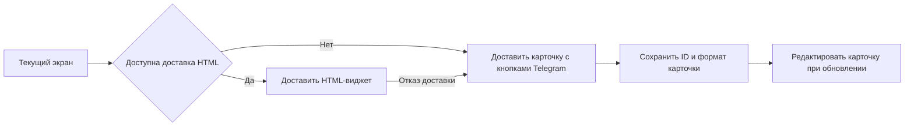

# План восстановления обычного интерфейса Telegram

Цель — сохранить управление ботом через кнопки Telegram при отключении HTML или отказе отправки виджета. Пользовательский выбор интерфейса и формат последнего доставленного сообщения учитываются отдельно.

| Блок | Исполнитель | Критерий приёмки |
| --- | --- | --- |
| 1. Транспорт Telegram | Агент транспорта | Обычные команды и нажатия поступают через стандартный Bot API. Если сервер отклоняет подписку на `widget_query`, опрос продолжает получать обычные события с тем же смещением. |
| 2. Переход между форматами | Координатор | Формат сообщения сохраняется вместе с его ID. После отключения HTML старый экран заменяется рабочей карточкой, включая график. После отказа `sendWidget` фоновые обновления редактируют обычную карточку, а подписки снова доставляют уведомления в чат. |
| 3. Видео камер | Агент камер | Обычный интерфейс один раз показывает локализованный итог отправки видео. Перекрывающиеся операции по-прежнему защищены, а цикл ожидания HTML-подтверждения применяется к HTML. |
| 4. Графики и выбор вида | Агент графиков | После перехода в обычный вид выбранный точный период отображается до смены пользователем. Доступны текущий период и пресеты. Просроченный период заменяется рабочим диапазоном, а настройки показывают фактически доступный режим. |

## Переход при отказе

После ошибки отправки HTML бот использует обычный вид в текущей сессии. Явный повторный выбор HTML разрешает новую попытку. При восстановлении старой сессии без сохранённого формата бот заново доставляет экран просмотра или открывает главное меню. Права доступа проверяются при восстановлении и отправке, а уже выполненные действия повторно не запускаются.

## Приёмка

1. Проверить целевые сценарии на локальных заглушках Telegram и Home Assistant, включая перезапуск с сохранённым графиком и два последовательных фоновых обновления после отказа `sendWidget`.
2. Проверить отправку видео в обычном и HTML-режимах, сохранение точного периода и смену диапазона через обычные кнопки.
3. Прогнать полный набор Rust-тестов, форматирование, Clippy и проверки HTML-виджетов. Сверить общий diff с критериями по каждому блоку.
