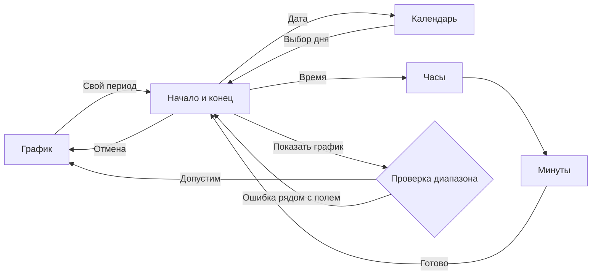

# График и выбор периода внутри сообщения

Проект UI/UX от 2026-11-07. **Календарь и точный диапазон пока не реализованы.**
Документ продолжает [DESIGN.md](DESIGN.md); состояние интеграции описано в
[RELEASE.md](RELEASE.md). Предлагаемое поведение требует проверки размера сборки
и поддержки абсолютных дат на сервере.

## Возможности HTML в чате

В [профиле Telegram Widget v1](https://github.com/TelegramMessenger/widget-sandbox/blob/main/docs/profile-v1.md)
поля `input`, `select`, `textarea` исключены, виджет не получает клавиатурный
фокус. Поэтому нативное поле даты или ввод с клавиатуры внутри карточки
недоступны. Календарь из кнопок, выбор времени и числовая клавиатура из кнопок
возможны. Запросы идут к боту через `TelegramWidget.request`; отдельный сайт
или внешние ресурсы для этого не нужны. Текстовые имена и длинные значения
пока удобнее вводить сообщением в чат, сохраняя возврат в исходную карточку.

## Что работает сейчас

`graph.html` показывает историю, текущее значение, пресеты 12/24 часа и 3/7 суток,
сдвиг окна, возврат и обновление. В продолжении доступны остальные действия.
Общий `r1.js` обрабатывает запросы, подтверждения, ошибки и отзыв доступа.
Размер артефакта после исправления нижней полосы — 4013 из 4096 байт zlib;
свободно 83 байта.

«Свой интервал» открывает ввод числа часов сообщением в чат. Backend принимает
длительность 1–240 часов и смещение конца −240…0 часов; это относительное окно,
а не две точные даты. Начало такого окна может оказаться до 480 часов назад.
Константа `MAX_HISTORY_DAYS` не доказывает фактическую глубину истории HA.

Карточка имеет высоту 600 px. Свободная высота увеличивает диаграмму; её минимум —
144 px. При известных размерах угла часов нижняя навигация использует свободную
сторону полосы. Для графика достаточно 200 px свободной ширины карточки после
вычитания угла; счётчик сокращён до `1/3` без слова «Страница». Обычный release
сохраняет прежний порог 256 px. Иначе резервируется полный нижний отступ.

Воспроизведён случай: при ширине 320 px и угле часов 120 px прежний порог
256 px оставлял всю полосу 64 px. Новый порог позволяет использовать свободную
сторону. При угле 121 px на той же ширине полный резерв сохраняется.
Это воспроизводимая причина в локальной модели; соответствие конкретному
отступу на клиенте пользователя пока не подтверждено.

## Первая карточка графика

Рекомендуемый порядок: верхняя строка «Назад / комната / обновление», название,
растягиваемый график с границами периода, точное текущее состояние, сдвиг окна,
два ряда пресетов, нижняя строка «Свой период / Ещё».

«Свой период» открывает редактор диапазона; «Ещё» — существующие подробности
и дополнительные действия. На первом экране эти подписи понятнее счётчика
«Страница 1/3». Перелистывание продолжений и возврат сохраняются.
Все кнопки имеют цель не меньше 44 × 44 px; они не уменьшаются ради графика.

Нижняя строка занимает только свободную часть полосы часов. «Свой период» и
«Ещё» требуют отдельной проверки при минимальных 176 px внутри боковых полей
(порог графика 200 px минус поля 24 px). Если ширины не хватает,
строка поднимается над полной safe area. Подписи и цели не обрезаются.
Пустой footer высотой 44 px нельзя просто удалить: он может удерживать последний
полноширинный ряд выше занятого часами угла. До появления календаря такую
свободную строку можно занять существующим «Обновить», переместив его сверху
без дублирования. Нижние 12/16 px не подходят для отдельной кнопки.

## Редактор периода

Редактор временно заменяет график **в том же `graph.html` и сообщении**.
Открытие, редактирование и отмена не читают историю HA. Даты первоначально
равны точным границам отображаемого графика. Черновик хранится на сервере;
его кнопки используют обычные выданные сервером ключи r1.

Обзор диапазона содержит две группы: «Начало» и «Конец». В каждой отдельные
кнопки даты и времени, затем видимая зона времени и кнопка «Показать график».
«Отмена» возвращает прежний график и прежний период. Возврат из календаря
или выбора времени ведёт к обзору черновика, не в комнату.

### Дата

Верхняя строка обозначает редактируемую границу и возврат. Ниже — месяц и год
со стрелками, подписи дней недели и календарь. Выбранный день выделяется рамкой
и состоянием `aria-pressed`; сегодняшний день не считается выбранным автоматически.
Выбор дня обновляет только черновик и возвращает обзор. Отдельной кнопки
применения в календаре нет, поэтому шесть недель помещаются по высоте.

Для семи колонок по 44 px нужны 308 px чистой ширины. При ширине карточки
320 px поля именно календарной сетки составляют 6 px, зазоры между колонками
отсутствуют. Остальной экран сохраняет обычные поля. При 360–430 px используются
семь равных колонок. Расчёт для шести недель и safe area 64 px: верхняя строка
44 + месяц 44 + дни недели 16 + даты 264 + поля/промежутки 28 + safe area 64
= 560 px. Это оценка, а не результат браузерной проверки реализации.

При ширине меньше 320 px используется недельный календарь: стрелки между
неделями и семь дат в трёх колонках, каждая с днём недели. Цели остаются ≥44 px;
горизонтальной прокрутки нет. Запрещённые сервером даты видны как недоступные
и не отправляют запрос. Допустимость времени внутри граничного дня проверяется отдельно.

### Время

Часы и минуты выбираются отдельными шагами без клавиатуры. Часы 00–23 —
сетка из четырёх колонок; при 200 px она помещается без горизонтальных зазоров.
После выбора часа открываются минуты: 00, 05, …, 55 в трёх колонках,
кнопки «−1 мин / +1 мин» и «Готово». Выбранное `HH:mm` постоянно видно.
Так доступны все минуты, а не только кратные пяти. Шаг через 00/59 не меняет
час скрытно: граничная кнопка недоступна; час меняется явным возвратом.

## Обратная связь и точность

До успешного применения график и его период не считаются изменёнными.
Во время запроса используется общее ожидание r1. Ошибка валидации сохраняет
черновик и называет конкретную границу; другая дата не исправляется автоматически.
Сетевой таймаут оставляет общий путь восстановления через «Обновить» без
автоматического повторения «Показать график». Обновление редактора возвращает
серверный черновик, а не применяет его. Отзыв доступа очищает данные.

Backend должен принимать точные абсолютные начало и конец и проверять:

- начало раньше конца;
- минимальную и максимальную длительность;
- разрешённые раннюю и позднюю границы;
- корректность времени в выбранной зоне, включая неоднозначные и отсутствующие
  местные часы при переводе времени.

Параметры допустимого диапазона задаёт сервер. Начальное предложение — сохранить
нынешние пределы длительности 1–240 часов, но выбирать границы с точностью
до минуты; окончательные пределы требуют решения backend. Округлять календарный
выбор к старым `h/o` и показывать его как точный диапазон нельзя.

Используется явно указанная зона сервера/HA; зона браузера не выбирается молча.
RU и EN используют 24-часовое время и название месяца: «7 ноя 2026» / «7 Nov 2026».
Подписи: «Начало / Конец / Свой период / Показать график / Отмена» и
«Start / End / Custom range / Show chart / Cancel». Ошибка, например:
«Конец должен быть позже начала» / «End must be after start».

## Ограничения реализации и приёмка

Новый режим должен оставаться внутри существующего asset; новый HTML потребовал
бы нового сообщения. Сначала нужен проверяемый прототип размера: 83 свободных
байта недостаточно для календаря. Общий r1 transport сохраняется. Серверная
генерация календаря и opaque keys уменьшает клиентскую логику, но месячная
страница с 31 кнопкой отдельно проверяется на лимит данных 1000 байт
и ответа 1024 байта. График, календарь, часы и минуты не передаются вместе.
Текущий graph-renderer допускает до четырёх рядов по три кнопки: сеткам
календаря и часов нужны отдельные режимы разметки и проверки входных данных.
Просто передать больше кнопок в существующее состояние недостаточно.

Критерии приёмки:

- Все режимы ≤600 px, без внутренней прокрутки; кнопки ≥44 × 44 px.
- RU/EN, обе темы, 200/320/360/430 px; safe area 0/24/64 px, часы слева и справа.
  Отдельно: угол 120 px при ширине 320/360 px, полный резерв при угле 121 px
  на ширине 320 px и длинный счётчик `9998/9999`.
- Месяц из шести недель, граница года, високосный февраль; все минуты доступны.
- Все прежние действия графика сохранены, календарь не создаёт новое сообщение.
- Точные границы результата равны подтверждённому выбору; возврат и отмена
  сохраняют предыдущий период. Пустая история остаётся допустимым результатом.
- Таймаут, поздний ответ, обе гонки ACK/push, отзыв доступа, изменение темы
  и ширины не приводят к незаметному применению или потере черновика.
- Финальная сборка ≤4096 байт zlib и ≤32768 исходных байт; каждое состояние
  календаря укладывается в серверный бюджет данных.

Открыты точные пределы абсолютного диапазона, политика часового пояса и
результат прототипа по размеру. Пользователь уточнил расположение остаточного
отступа: под навигацией, рядом со временем сообщения. Изменение применения
отступа описано в DESIGN 1.23; локальный preview не доказывает причину на клиенте.
