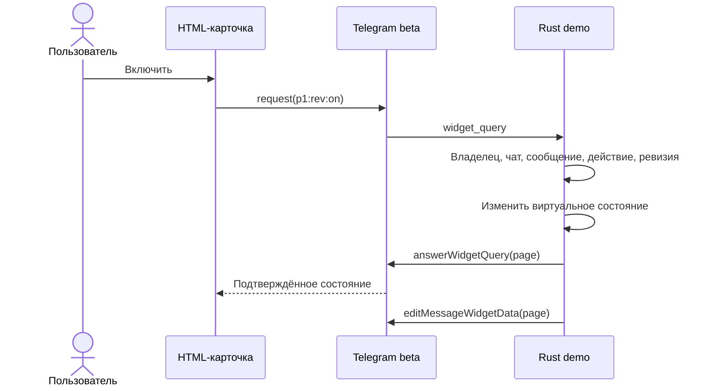

# Архив: HTML-интерфейс на первом этапе переноса

> Этот документ описывает изолированное демо от 6 ноября, а не текущую полноту
> основного бота. Рабочий интерфейс и запуск описаны в [RELEASE.md](RELEASE.md),
> обязательная структура — в [SCREENS.md](SCREENS.md), обнаруженные расхождения —
> в [аудите от 8 ноября](AUDIT-2026-11-08.md). Утверждения ниже о ещё не перенесённых
> разделах относятся только к историческому этапу демо.

Дата: 6 ноября 2026 года. Ветка: `feat/html-interface-migration`.
Правила оформления: [«Дом» 1.1](DESIGN.md), токены `1.0.0`.

## Что работает

В изолированном деморежиме доступны пять страниц: Дом, Комнаты, Гостиная,
Торшер и Вид интерфейса. Каждая имеет обычное представление с inline-кнопками
Telegram и новое HTML-представление. Обе версии используют одну модель страниц
и одно виртуальное устройство. Выбор вида сохраняется после перезапуска.

Основной бот пока работает по прежним маршрутам. Камеры, климат, сенсоры,
сценарии, администрирование, уведомления и реальные устройства ещё не
подключены к HTML. [Карта экранов](SCREENS.md) сопоставляет существующие действия
с дизайном следующих этапов. HA подключается только после отдельного сообщения
владельца; демо не открывает основную SQLite и не запускает HA-клиент или workers.

## Проверка через cargo run

Добавьте поле в существующий файл по `OPTIONS_PATH`, сохранив остальные настройки:

```json
"widget_demo_enabled": true
```

```sh
cargo run
```

Бот использует настроенные `bot_token` и `root_user`, отправляет «Дом» в личный
тестовый чат. Первоначально выбран HTML; далее используется сохранённый вид.

| Действие | Результат |
|---|---|
| Дом → Комнаты → Гостиная → Торшер | Открывается виртуальное устройство |
| Включить / Выключить | Изменяется только виртуальное состояние |
| Мои настройки или `/ui` | Выбор «Обычный / HTML» |
| `/classic` | Текущий экран появляется с кнопками Telegram |
| `/html` | Текущий экран появляется как HTML-карточка |
| `/start` или `/demo` | Новое сообщение с главной страницей |
| Обновить | Состояние читается без повторения предыдущей команды |

При смене вида экран и состояние устройства сохраняются. При новом запуске
торшер выключен и открывается Дом; сохранён только выбор представления.
Он хранится рядом с файлом настроек, в
`widget-demo-interface-<bot_id>-<user_id>.json`, отдельно от токенов и основной БД.
Формат: `{"version":1,"mode":"html"}` или `"classic"`. Запись через временный
файл и rename. Некорректный файл настроек не перезаписывается молча: запуск
завершается с ошибкой чтения предпочтения.

Новое сообщение сначала доставляется, затем сохраняется предпочтение и
удаляется старое сообщение. Если доставка или сохранение не удались, прежнее
представление остаётся действующим. Старый ID сообщения отклоняется, даже если
Telegram не смог удалить его. Переключение не воспроизводит действие устройства.
При недоступности отправки HTML на старте открываются обычные кнопки;
сохранённое предпочтение остаётся прежним. Если HTML не поддерживает конкретный
клиент Telegram, команда `/classic` доступна вне карточки.

Остановка — `Ctrl+C`. Перезапустите процесс после изменения Rust или `dist`.
Карточки принимают запросы только пока работает процесс; после перезапуска
используйте новое сообщение. Не запускайте два polling-процесса с одним токеном.
Демо не удаляет webhook: при настроенном webhook запуск прекращается.
При завершении восстанавливается прежний `allowed_updates`.

Для штатного бота: `widget_demo_enabled: false`, когда доступ к HA будет разрешён.
Это отдельная настройка запуска, не переключатель внешнего вида.

## Сборка и локальный просмотр

HTML встроен в Rust через `include_str!`. Для обычного `cargo run` Node.js
не требуется. После изменения исходников UI пересоберите сохранённые артефакты:

```sh
cd ui/widgets
npm ci --ignore-scripts
npm run build
npm test
npm run check:browser
```

Сборка использует Node.js, esbuild и Python 3 для точного расчёта zlib level 9.
Для браузерной проверки нужен установленный Chromium; macOS-кэш Playwright
определяется автоматически, либо задайте `HA_WIDGET_CHROME`. Браузер запускается
с отключённой сетью. Проверка не устанавливает браузер и не требует HTTP-сервера.

Откройте с диска:

- `ui/widgets/dist/panel-preview.html`: пять страниц, обе темы, ширины 200–430 px,
  переходы и симуляция обычного/HTML вида. Здесь выбор живёт до обновления файла.
- `ui/widgets/dist/preview.html`: первый switch-компонент, подтверждение,
  только просмотр, недоступность, отзыв доступа, задержка и ошибка.

В Telegram отправляется только `dist/panel.html`. Оболочки preview и симуляторы
туда не попадают. `dist/switch.html` сохранён как отдельный компонент для следующих
этапов; его серверные критичные подтверждения ещё не подключены к основному боту.
Виджеты не загружают внешние ресурсы. На каждый payload проверяются пределы
32768 байт исходника и 4096 байт zlib. Значения записываются в manifests.

## Файлы

| Путь | Назначение |
|---|---|
| `ui/widgets/design-tokens.json` | Общие цвета, размеры, интервалы и темы |
| `ui/widgets/src/panel.{html,css,js}` | Универсальная страница демонавигации |
| `ui/widgets/src/switch.*`, `components.css` | Первый выключатель и сложные состояния |
| `ui/widgets/preview/` | Автономные симуляторы и оболочки проверки |
| `ui/widgets/build.mjs`, `dist/` | Сборка, артефакты и контроль размера |
| `src/widget_demo.rs` | Telegram transport, сессия, смена представления, polling |
| `src/widget_demo/model.rs` | Общая модель страниц и допустимых действий |
| `src/widget_demo/preferences.rs` | Версионированное хранение выбранного вида |
| `src/widget_demo/tests.rs` | Проверки на локальной HTTP-заглушке Telegram |
| `DESIGN.md`, `SCREENS.md` | Сохранённые правила дизайна и карта следующих этапов |

## Контракт panel p1

Это прикладной контракт демо, не стандарт Telegram. HTML неизменен после отправки;
страницы и значения приходят через приватный `chat_data`. Поля модели и
соответствие существующим маршрутам перечислены в [SCREENS.md](SCREENS.md).

Запрос: `p1:<rev>:<action>`, до 64 байт. Ответ `TelegramWidget.request()` содержит
строку `result`; её JSON — `{"page":...}`, `{"transition":true}` либо
`{"denied":true}`. В Bot API ответ отправляется методом `answerWidgetQuery`
через поле `data`; данные сообщения обновляются `editMessageWidgetData`.
Ответ отправляется до редактирования сообщения, чтобы сетевой вызов редактирования
не расходовал срок ответа на нажатие. Обычные запросы ограничены 8 секундами,
long polling — 35 секундами.

Допуск проверяется сервером: только владелец, личный чат, текущий ID сообщения,
соответствующий транспорт, доступное на текущей странице действие и ревизия.
Повторные и устаревшие команды не исполняются. `read` может читать свежие данные
при устаревшей ревизии, поскольку это безопасное восстановление после ошибки.
`on/off` — явное желаемое состояние; оптимистического изменения UI нет.
При неопределённом результате изменения блокируются до успешного обновления.
Пересланные карточки скрывают приватные данные и не получают управление.



У первого switch-компонента сохранён контракт `w1:<id>:<rev>:on|off|read`.
Его preview дополнительно поддерживает `pending` и сервероподобные confirm-токены.
Новый polling не принимает w1 как команду panel.

## Проверки и дальнейшая интеграция

Проверены: переходы, переключение в обе стороны с сохранением состояния,
перезапуск хранилища предпочтения, сбой доставки/записи при смене вида,
отказ чужим и устаревшим сообщениям, порядок ответа и редактирования.
Браузер проверяет обе темы и 200–430 px, высоту до 600 px, цели нажатия от 44 px,
экранирование имён, повторные нажатия, ошибку, отзыв доступа и гонки перехода.

На этом этапе полный набор Rust: 418 прошли, 2 live HA теста пропущены.
JavaScript: 9 тестов switch и сценарная браузерная проверка switch/panel.
`cargo clippy --all-targets -- -D warnings` проходит. Telegram beta принял
новую панель в тестовый чат; совместимость всех её переходов с нативными клиентами
дополнительно проверяется владельцем.

Подключение реальных экранов требует адаптера к существующим маршрутам,
проверкам допуска/ACL, журналу и серверным подтверждениям. HTML не является
источником прав, идентификаторов разрешённых целей или подтверждений.
Отдельные пользовательские настройки и fallback неподдержанных экранов основного
бота относятся к следующему этапу, не к текущему демонстрационному переключателю.

## Telegram API

6 ноября 2026 года обычный endpoint `/bot…/sendWidget` вернул 404;
официальный `/beta/bot…/sendWidget` принял пилот и новую панель с существующим токеном.
Демо использует beta; общий Teloxide dispatcher пока не изменён.
Клиент соединяется только с Telegram. Внешний сайт или публичный backend не нужен.

Источники: [SDK и запросы](https://github.com/TelegramMessenger/widget-sandbox/blob/main/docs/sdk-v1.md),
[Bot API для виджетов](https://github.com/TelegramMessenger/widget-sandbox/blob/main/docs/tgw-format.md#the-bot-api-104),
[профиль HTML/CSS/JS](https://github.com/TelegramMessenger/widget-sandbox/blob/main/docs/widget-runtime-profile.md).

## Архив контракта panel p1

Состав: `panel.html` + `panel.css` + `panel.js`. Источник данных — `TelegramWidget.chatData`; в локальном preview его заменяет симулятор. Файлы не подключаются к HA самостоятельно и не содержат внешних ресурсов.

| Поле модели | Содержание |
|---|---|
| `v`, `rev` | Версия 1 и неотрицательная ревизия состояния |
| `screen` | `home`, `rooms`, `room`, `device` или `settings` |
| `eyebrow`, `title`, `description` | Контекст, заголовок и короткое пояснение |
| `hero` | `null` или `{label, value}` для основного значения |
| `items` | До четырёх `{label, detail, action, selected, primary}` |
| `nav` | До трёх `{label, action}` для возврата и разделов |

Допустимые действия: `home`, `rooms`, `room`, `device`, `settings`, `classic`, `html`, `on`, `off`, `read`. Запрос — `p1:<rev>:<action>`. ID комнаты и прибора определяются демонстрационным сервером; эта короткая схема не является универсальным протоколом для произвольного дома.

Ответ содержит `page` с новой моделью, `transition: true` при смене сообщения или `denied: true` при отказе. Страницы со старой ревизией не заменяют новые. Пересланный виджет скрывает исходные данные. После неопределённого результата изменения запрещены до успешного `read`; автоматического повторного включения/выключения нет.

### Соответствие существующим действиям

Это семантическое соответствие для будущего адаптера; перечисленные Rust-маршруты не вызываются самим демонстрационным panel.

| Действие panel | Существующий маршрут основного бота |
|---|---|
| `home` | `Payload::Home` |
| `rooms` | `ControlPayload::ListRooms` |
| `room` | `ControlPayload::RoomDetail { room }` |
| `device` | `ControlPayload::DeviceControl { room, device }` |
| `settings` | `PersonalPayload::Settings` |
| `on`, `off` | `ControlPayload::QuickAction` с `DeviceCmd::TurnOn` / `TurnOff`, через существующие проверки и подтверждения |
| `read` | Текущий безопасный маршрут просмотра; не повтор последнего изменения |
| `classic`, `html` | Новое предпочтение отображения; отдельная операция без физического действия |
