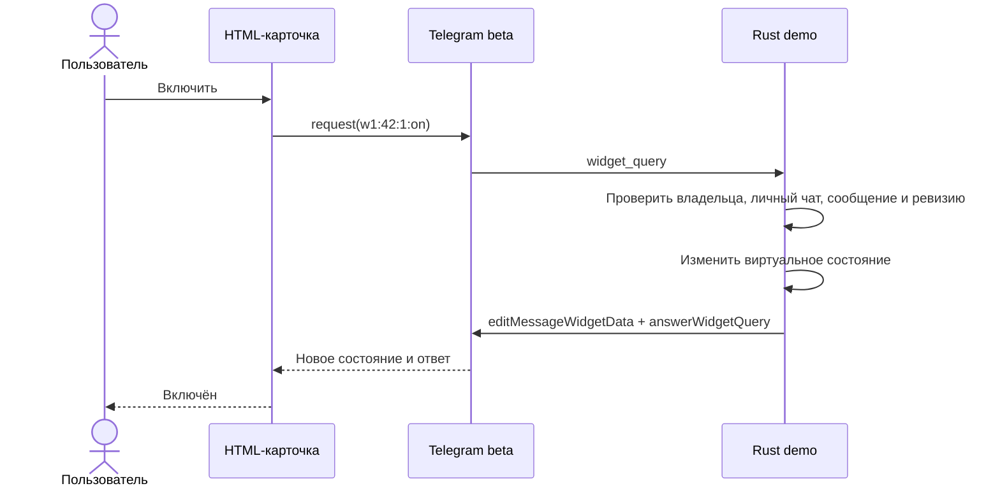

# HTML-пульт: пилот выключателя

Дата: 6 ноября 2026 года. Система оформления: «Дом» 1.0.

## Что реализовано

Первый экран — карточка одного светильника. HTML-переключатель отправляет
явную команду `on` или `off`, обновление запрашивает состояние. Экран показывает
ожидание, ошибку, просмотр без управления и отзыв доступа. В локальном
предпросмотре дополнительно доступны подтверждение критичного действия,
пересланная карточка и задержка фактического изменения состояния.

Режим `cargo run` использует отдельный Rust-обработчик с виртуальным торшером.
Он не импортирует HA-клиент, не открывает SQLite и не запускает фоновые задачи
основного приложения. К реальным устройствам доступ пока отсутствует; подключать
их можно только после отдельного сообщения владельца. Исходные экраны основного
бота пока сохраняются.

## Посмотреть через cargo run

В существующий файл по `OPTIONS_PATH` добавьте поле, сохранив токен и владельца:

```json
"widget_demo_enabled": true
```

Запустите из корня репозитория:

```sh
cargo run
```

После запуска бот отправляет новую карточку `root_user` в личный чат. Нажмите
«Включить свет», дождитесь ответа, затем «Выключить свет» и «Обновить».
Устройство помечено как демонстрационное. Процесс должен оставаться запущенным,
иначе запросы из карточки завершатся таймаутом. После перезапуска пользуйтесь
новой карточкой: старые сообщения больше не принимают команды.

Остановка — `Ctrl+C`. Для штатного запуска укажите `widget_demo_enabled: false`.
Демо не изменяет токен, не удаляет webhook и не требует `HA_TOKEN`. Если webhook
настроен, запуск останавливается с объяснением. Не запускайте два обработчика с
одним токеном. При штатном завершении восстанавливается прежний список
`allowed_updates` Telegram.

HTML встроен в Rust-бинарник через `include_str!`: для обычного `cargo run`
Node.js не нужен. Если изменили HTML/CSS/JS, сначала пересоберите артефакт.

## Автономный просмотр и сборка

Откройте `ui/widgets/dist/preview.html` в браузере прямо с диска. Весь пример
самодостаточен; сетевые запросы запрещены Content Security Policy. Оболочка
симулирует `TelegramWidget` только в iframe, показывает светлую/тёмную тему,
разные ширины и сценарии. В отправляемом `dist/switch.html` симулятора нет.

Для разработки нужны Node.js, npm и Python 3 (точный расчёт zlib):

```sh
cd ui/widgets
npm ci --ignore-scripts
npm run build
npm test
```

Браузерная проверка использует уже установленный Chromium через DevTools pipe:

```sh
HA_WIDGET_CHROME="/путь/к/Chromium" npm run check:browser
```

На macOS также автоматически находится Chromium в кэше Playwright. Скрипт
не скачивает браузер и не запускает HTTP-сервер. Снимки сохраняются в
`ui/widgets/screenshots/` (локальные, исключены из Git). Браузерная вкладка во
время проверки работает с отключённой сетью. Это проверка композиции и логики,
а совместимость с нативным Telegram проверяется отдельно в чате.

## Файлы и переиспользование

| Файл | Назначение |
|---|---|
| `ui/widgets/design-tokens.json` | Основные значения цвета, размеров, интервалов, тем и версия дизайна |
| `ui/widgets/src/tokens.css` | CSS-представление всей системы токенов |
| `ui/widgets/src/components.css` | Общие классы карточки, состояния и контролов |
| `ui/widgets/src/switch.html` | Структура первого экрана |
| `ui/widgets/src/switch.js` | Контроллер и обращение только к `TelegramWidget` |
| `ui/widgets/preview/` | Локальный просмотр и симулятор, не попадают в Telegram payload |
| `ui/widgets/build.mjs` | Минификация, проверка размера, сборка самодостаточных HTML |
| `ui/widgets/dist/` | Сохранённые HTML и manifest; должны обновляться вместе с исходниками |
| `src/widget_demo.rs` | Изолированный запуск и обработка Telegram beta API, только виртуальное состояние |
| `docks/html-widgets/DESIGN.md` | Правила оформления будущих экранов |

Сборка включает только используемые токены; полный набор сохраняется в JSON
и генерируется в `tokens.css`. HTML проверяется на ограничения 32768 байт исходника и 4096 байт
zlib level 9. Шрифты, картинки, скрипты и стили с внешних сайтов не загружаются.

## Контракт пилота w1

Это наш локальный прикладной контракт, не стандарт Telegram. Состояние
передаётся только в приватном `chat_data`, без `public_data`/shared widget:

```json
{
  "v": 1, "id": "42", "rev": 1,
  "name": "Торшер · демо", "room": "Гостиная",
  "state": "off", "access": "control", "critical": false
}
```

Запрос: `w1:<id>:<rev>:on`, `off` или `read`; максимум 64 байта.
`TelegramWidget.request()` получает ответ `{result: "JSON"}`, внутри JSON —
`{"state": ...}`. В Bot API это `answerWidgetQuery` с полем **data**. Ответ сам
по себе не редактирует состояние сообщения: Rust также вызывает
`editMessageWidgetData`. Ревизия предотвращает повторное исполнение и откат от
запоздалого ответа. Кнопки блокируются во время запроса. После неизвестного
результата управления можно только обновить состояние; автоматического повтора
команды нет.

Локальный симулятор расширяет ответ полями `pending: true` и
`confirm: {token, action, expires}` (expires — Unix milliseconds). Эти сценарии
нужны для дизайна и тестов. В Telegram-демо доступен только обычный выключатель;
подключение серверных подтверждений к основной БД ещё не выполнено.



## Проверка и границы интеграции

- AC-01: `cargo run` с флагом демо работает без доступного HA и без открытия БД.
- AC-02: переключение меняет только виртуальное состояние после ответа бота.
- AC-03: старый запрос с прежней ревизией не выполняет повторное действие.
- AC-04: управление принимается только от `root_user` в текущем исходном личном сообщении.
- AC-05: локальный preview проверяет ошибку, отсутствие прав и подтверждение.
- AC-06: отправляемый HTML не содержит симулятора и укладывается в лимит размера.

Для реального HA понадобится адаптер запросов к `core::devices` и существующим
проверкам допуска/ACL, критичным подтверждениям и журналу. Виджету нельзя
доверять идентификаторы целей, состояние прав или факт подтверждения; всё это
проверяет бот. Отправка команды и подтверждённое состояние устройства остаются
разными событиями. Адреса HA/камер и токены не передаются в HTML.

## Статус Telegram API

6 ноября 2026 года на настроенном тестовом боте обычный
`https://api.telegram.org/bot…/sendWidget` вернул 404. Официальный endpoint
`https://api.telegram.org/beta/bot…/sendWidget` распознал метод; `getMe` подтвердил
действительность настроенного токена. Поэтому демо использует именно beta;
добавлять поддержку в общий Teloxide dispatcher пока не требуется.

Проверено: `cargo run` успешно отправил собранную карточку в настроенный тестовый
чат через beta API. Локальные проверки: 414 Rust-тестов прошли, 2 проверки
реального HA пропущены; 9 JavaScript-тестов и браузерная проверка с отключённой
сетью прошли. В браузере проверены обе темы, ширины 200–430 px, длинные названия,
подтверждение, повторные нажатия, ошибка и отзыв доступа. Нативное отображение
карточки и нажатия в Telegram на устройствах владельца ещё требуют проверки.

Источники: [SDK и запросы](https://github.com/TelegramMessenger/widget-sandbox/blob/main/docs/sdk-v1.md),
[Bot API 10.4](https://github.com/TelegramMessenger/widget-sandbox/blob/main/docs/tgw-format.md#the-bot-api-104),
[профиль HTML/CSS/JS](https://github.com/TelegramMessenger/widget-sandbox/blob/main/docs/widget-runtime-profile.md).

Внешний сайт или публичный сервер не требуется ни для пилота, ни для планируемого
управления: клиент общается с Telegram, Rust-бот — с Telegram и локальным HA.
