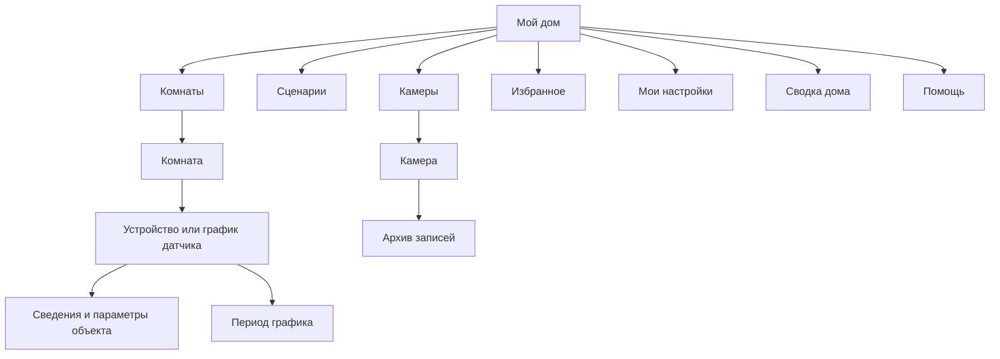
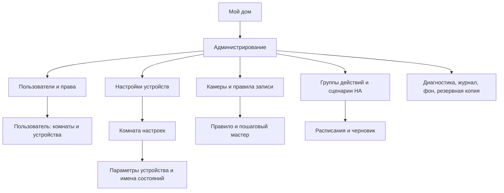

# Структура экранов и сохранение функциональности

Версия 2.3 · 9 ноября 2026 года · ветка `feat/html-interface-migration`.

Уточнение навигации 9 ноября: HTML показывает каждый callback только один раз.
Возврат к родителю находится в шапке, а на первом уровне он же возвращает домой.
Прямой «Дом» сохраняется на основной карточке объекта; в «Подробностях» устройства
и камеры, а также в формах ввода он не повторяется. Там используется «Назад» к
карточке. Повторные подписи не определяют назначение: дедупликация сравнивает
маршруты, сохраняя действия, исходные ключи, пагинацию и классический fallback.
Это уточняет UX-07 для вложенных сведений и форм.

Исключение для термостата: в HTML-карточках климата (с ползунком и без него)
отдельного «Дом» нет. Выход — через «Назад» к комнате или источнику открытия;
«Подробности» занимают отдельную строку.

Переход `Payload::Home` в кнопках везде называется «Дом» / «Home» через общий
словарь `common.main_menu`, без отдельных переименований в карточках.
«Назад» обозначает возврат к родителю; название главного экрана — «Мой дом».

«Избранное» и уведомления устройства остаются в его основной карточке (для датчика
— на графике). HTML-раздел «Подробности» содержит сведения и диагностику, без
повторного набора этих действий; возврат к управлению — через «Назад».

Термостат: под ползунком один ряд «Применить» и «Включить/Выключить отопление».
Кнопка режима появляется только при наличии соответствующего `heat`/`off` в
`hvac_modes` и права управления. Она отправляет `climate.set_hvac_mode` выбранной
сущности, не применяя локальный черновик температуры. Оба управляющих элемента
блокируются до подтверждения режима выбранной сущностью HA; температура воздуха,
уставка или режим другой головки не являются подтверждением. При неопределённом
результате доступно чтение состояния через обновление. Критичные устройства
сохраняют отдельное подтверждение. В классическом виде кнопка режима тоже доступна.

Это контракт структуры для дальнейшей доработки, а не заявление о завершённом
переносе. Текущие несоответствия, их происхождение и приоритеты перечислены в
[аудите UI/UX](AUDIT-2026-11-08.md). Правила оформления — [DESIGN.md](DESIGN.md),
протокол и запуск — [RELEASE.md](RELEASE.md), календарь — [GRAPH_UX.md](GRAPH_UX.md).
При расхождении с ранними проектными разделами DESIGN действует эта карта и
перечисленные ниже решения пользователя. Токены оформления остаются `1.0.0`.

Уточнение после аудита: [план исправления](FIX_PLAN.md) сохраняет текущие
графики, календарь и возможности видео. Для видео добавляются ожидание до
завершения отправки и удаление вложения по существующему таймеру. Предложение
вернуть прямой «Дом» на график отложено; UX-07 ниже применяется с этим
исключением. Названия и состав кнопок самого графика в этом плане не меняются.

Этапы исправления выполнены; проверенные сценарии и граница нативной приёмки
перечислены в [результатах плана](FIX_PLAN.md#6-выполнение-и-проверка--8-ноября-2026).
Обычные списки используют одну панель стрелок для всех частей; текущий язык
отмечен выбранным. Видеодоставка удерживает ожидание до результата и удаляет
сообщения по `delete_notification_messages_timeout_s`, не затрагивая архив.

## 1. Основа сравнения

Эталон функций — классический бот до HTML-пилота, коммит `3a8b3c9`, плюс
последующие явно согласованные изменения. Сравнения только с текущей
inline-клавиатурой недостаточно: её тоже изменяли в ходе переноса.

| Согласованное изменение | Что сохранять при исправлениях |
|---|---|
| Общие статусы дома | Только главная и «Сводка дома»; состояние самого устройства остаётся в его карточке |
| Сообщения о переключениях | В HTML не отправлять отдельные обычные сообщения о каждом изменении устройства |
| Выбор периода | Календарь с часами и минутами; пресеты 12/24 ч, 3/7 д и сдвиг на сутки не возвращать в HTML |
| Полный график | Отдельный исходный PNG с точным периодом; полноэкранный режим HTML не добавлять |
| Два вида интерфейса | `/ui`, `/html`, `/classic` и персональный выбор сохраняются; подпись со сменой вида под карточкой не возвращается |
| Соединение | Клиент использует Telegram; внешняя панель управления не требуется |
| Ожидание | Мгновенный отклик, блокировка повторной команды, подтверждение состояния, явная ошибка/неопределённый результат |
| Геометрия | Стабильная высота, строки управления максимум в две текстовые строки, использование свободной высоты без перекрытия времени Telegram |

Доступ к реальному HA был разрешён владельцем 6 ноября. Аудит 8 ноября выполнен
на исходниках, изолированных моках и офлайн-предпросмотрах; он не включает
повторную приёмку на живом HA или в нативных клиентах Telegram.

## 2. Обязательный порядок блоков

Обычная карточка строится в одном порядке:

1. Общая шапка: возврат слева, родительский раздел в середине, обновление справа.
2. Название текущего экрана или объекта.
3. Краткое подтверждённое состояние либо суть вопроса/ввода.
4. Основные действия текущего объекта.
5. Дополнительные сведения и настройки через явно названные переходы.
6. Пагинация содержимого, если нужна.

Кнопка обновления во всех HTML-шаблонах имеет размер 44 × 44 px и отступы
12 px сверху и справа от карточки. Положение не меняется при появлении пагинации,
ожидании ответа или изменении области часов Telegram.

Стрелки перелистывания имеют размер 44 × 44 px и образуют компактную группу
176 px со счётчиком посередине. Группа центрируется в свободной части полосы
часов, если после вычитания занятых углов остаётся хотя бы 200 px. Иначе она
располагается выше всей полосы и центрируется по карточке. Часы не перекрывают
кнопки; их размер не уменьшается. Правило едино для меню, графика, календаря
и выбора часов/минут; скрытая панель не резервирует высоту.

На главной возврата нет; заголовок и обновление используют одну строку. На вложенных
экранах заголовок находится ниже шапки. У подтверждения вместо обычного возврата
показывается «Отмена». Поле ввода содержит название объекта, формат значения, ограничения
и отмену. Возврат, отмена и перелистывание — разные операции.

| ID | Обязательное правило | Проверка |
|---|---|---|
| UX-01 | Название описывает именно текущий экран; «Мой дом» относится к главной. Нельзя использовать fallback «Дом» для сведений/админки или «Мои настройки» для избранного | Проверить title/context каждого маршрута из каталога |
| UX-02 | Родитель определяется маршрутом, а не точным текстом кнопки. Возврат/отмена доступны на каждой локальной и серверной странице | Пройти первую и последнюю страницу, сравнить целевой callback |
| UX-03 | Путь к существующей функции сохраняется либо фиксируется в реестре переноса. Нельзя считать функцию сохранённой только потому, что обработчик существует | Пройти видимый путь от главной до действия в обоих видах |
| UX-04 | Основная команда, значение и объект видны вместе на первой странице при ширине от 320 px | Пульт света/климата/камеры и подтверждение не требуют поиска команды среди диагностического текста |
| UX-05 | Управление элементом списка не отделяется от его имени пагинацией | Имя избранного и его «Поднять/Удалить» остаются одной группой; иначе каждая кнопка содержит достаточную идентификацию |
| UX-06 | Обновление и смена вида не повторяют команды, не сбрасывают период, фильтр или страницу списка | После write выполнить Read, смену вида и возврат; проверить число физических команд и сохранённый контекст |
| UX-07 | Назад восстанавливает предыдущий контекст объекта/списка. Дом — отдельный доступный переход; обход через несколько родителей не заменяет бывшую кнопку Дом | Отдельно проверить вход из комнаты, избранного, графика и списка уведомлений |
| UX-08 | Текстовые строки управления ограничены двумя строками; длинное полное имя доступно в сведениях | Проверить каждое семейство, обе темы и ширины 200/320/360/430 px |
| UX-09 | Диагностика не вытесняет управление; служебный Debug не является основной страницей сведений | На первой странице только полезные значения и переходы, полный технический текст — в явном продолжении |
| UX-10 | Личные параметры и администрирование различаются названием, контекстом и родителем | «Мои настройки» не ведут к глобальным правам; административные комнаты помечены как настройки устройств |
| UX-11 | Подтверждение содержит объект, действие, последствия и срок, если он есть; выполнить/отменить видны вместе | Проверить критичные команды, удаление камеры/записи/пользователя и backup |
| UX-12 | Ошибка связи, отсутствие данных, устаревшая карточка и отказ в доступе различаются; переключение вида не предлагается как обход прав | Пройти отказ, тайм-аут, восстановление и старую ревизию |
| UX-13 | Выбранный язык/вид/фильтр отмечен явно, а недоступная функция объяснена | Проверить selected/disabled и подпись ограничения, в том числе фон только для classic |

Эти правила обязательны для исправления найденных дефектов. Наличие правила
не означает, что текущий код уже ему соответствует.

## 3. Иерархия пользователя



Переход из избранного открывает тот же объект с теми же правами; сохранённый
источник открытия нужен для возврата. Путь через настройки уведомлений также
не должен подменять родителя графика при возвращении из операции подписки.

| Экран | Обязательное содержимое и действия | Родитель/возврат |
|---|---|---|
| Мой дом | Комнаты, сценарии, камеры, избранное, мои настройки, помощь; администрирование только владельцу; компактные статусы и переход к полной сводке при наличии продолжения | Нет возврата |
| Сводка дома | Полный список доступных статусов с объектом, значением и временем; пустое состояние | Мой дом |
| Комнаты | Доступные комнаты, страницы списка, явное пустое состояние | Мой дом |
| Комната | Имя и подтверждённое состояние устройства; имя открывает карточку, отдельное действие управляет светом/выключателем | Комнаты с сохранением страницы |
| Свет/выключатель | Имя, состояние, включить/выключить при наличии права, ожидание, сведения, избранное, подписка | Комната или сохранённый источник |
| Климат | Текущая и заданная температура, режим, ползунок с шагом/границами HA и «Применить», включение/выключение отопления при поддержке, сведения, избранное, подписка | Комната или сохранённый источник |
| Точная температура | Объект, текущая уставка, единица, диапазон и формат; ввод сообщением в чат, отмена | Пульт климата |
| График сенсора | Диаграмма, точное текущее значение, даты и UTC; период, сведения, PNG, доступ к избранному/подписке; текущая навигация сохраняется, прямой Дом отложен | Комната или сохранённый источник |
| Период графика | Начало/конец, часовой пояс, Показать график, Отмена | Исходный график без применения черновика |
| Календарь | Выбранный день, допустимые дни, месяц/неделя, возврат к периоду | Обзор черновика периода |
| Часы/минуты | Два поля, все 24 часа и 60 минут, выбранное значение, Готово | Обзор черновика периода |
| Сведения об устройстве | Название устройства и комната, понятные значения, технические подробности; избранное/подписка остаются в исходной карточке | Исходный пульт/график с сохранённым периодом |
| Сценарии | Группы бота и доступные сценарии/скрипты HA; различимые типы и пагинация | Мой дом |
| Группа действий | Имя, состояние/состав, включить/выключить при праве, устройства группы, избранное | Сценарии или сохранённый источник |
| Сценарий HA | Имя и тип, запуск при праве, избранное, подтверждение при необходимости | Сценарии или сохранённый источник |
| Камеры | Доступные камеры, режимы записи, страницы/пустое состояние | Мой дом |
| Камера | Имя и комната, снимок, доступные длительности видео, активная запись/остановка при праве, архив, сведения, избранное | Камеры или сохранённый источник |
| Архив | Выбранная камера/фильтры, записи, страницы, пустое состояние, фильтры | Камера |
| Фильтры архива | Дата/правило/состояние с явным выбором и сбросом | Архив с сохранением камеры |
| Запись | Время, длительность, состояние/ошибки, сегменты, скачать/отправить, удалить при праве с подтверждением | Архив с сохранением фильтров и страницы |
| Избранное | Идентифицированные действия; открыть/выполнить, поднять первым, удалить; цель не теряется при пагинации | Мой дом либо Мои настройки по источнику |
| Добавление в избранное | Название объекта и допустимые действия; добавление не выполняет команду; отмена | Исходный объект |
| Мои настройки | Вид, язык, тихие часы, редактирование интервала, уведомления, избранное | Мой дом |
| Вид интерфейса | Обычный/HTML и единственная отметка текущего выбора | Мои настройки |
| Тихие часы | Текущее значение, часовой пояс, формат, отмена; сохранение интервала не включает тихие часы | Мои настройки |
| Мои уведомления | Доступные устройства, состояние подписки, страницы | Мои настройки |
| Подписка устройства | Название объекта, разрешение администратора, состояние подписки, включение/выключение | Источник: устройство/график или список уведомлений |
| Помощь | Доступные способы управления и ввод; функции, отключённые владельцем, отмечены | Мой дом |

Избранное и подписку графика нельзя прятать за неясным названием и страницами
диагностики. Допустим отдельный явно названный экран параметров объекта, если
переход находится на первой странице и сохраняет исходный график при возврате.
Текущее размещение за «Сведениями» отмечено как несоответствие обнаружимости
в аудите. По уточнению пользователя кнопка на графике сохраняется; исправление
затрагивает порядок содержимого общего экрана сведений. Эта таблица
не объявляет его завершённым исправлением.

## 4. Администрирование



| Семейство | Что нельзя потерять | Структурное правило |
|---|---|---|
| Пользователи/права | Добавление, удаление с подтверждением, имя, роль, язык, голос, доступ к комнатам/устройствам/уведомлениям, сброс/наследование | Заголовок содержит раздел и выбранного пользователя; контекст не теряется на страницах |
| Настройки устройств | Видимость, уведомления, имя, алиасы состояний, инверсия, критичность; только разрешённые владельцу действия | Отличать от пульта; закреплённый возврат к устройствам комнаты и из алиасов к параметрам |
| Настройки камер | Снимок/видео, диагностика, добавление, удаление с подтверждением, связь с комнатой | Не смешивать «Сведения камеры» пользователя и административные настройки |
| Правила/группы записи | Включение, редактирование, копирование, удаление, условия, расписание активности, дни, pre-roll, интервалы, хранение, шум, уведомления, группы и права | Шаг мастера имеет название, выбранную камеру/правило и понятный возврат; ввод не создаёт вторую копию черновика |
| Сценарии/состав | Список и управление группами, состав, доступность, критичность, HA-цели | Обычный запуск отделён от редактирования и удаления |
| Расписания | Список, карточка, время, дни, команда, создание/изменение, сохранение, включение/выключение, отмена, удаление | Основные поля черновика и действия не отделяются от его идентичности пагинацией |
| Диагностика/журнал | Состояние и фильтры, безопасное обновление | Обновление не выполняет повторно физическую команду |
| Фон UI | Выбор камеры и интервал для классических сообщений | Явно указать область действия: к HTML-карточкам фон не применяется |
| Резервная копия | Подтверждение, отдельная доставка файла | Цель/действие/отмена на одном экране; чтение не создаёт новую копию |

Пользователь без соответствующего права не получает данные или доступные
кнопки этих маршрутов. Смена интерфейса не меняет проверок доступа.

## 5. Семейства виджетов и транспорт

| Артефакт | Назначение | Статус |
|---|---|---|
| `switch.html` | Изолированный пилот лампы | Демонстрация; не эталон полноты рабочего бота |
| `panel.html` | Демо из пяти страниц: дом, комнаты, комната, лампа, вид | Ограниченный demo-протокол p1; не переносить его ограничения в рабочие экраны |
| `release.html` | Общий адаптер рабочих меню, пультов, списков, подтверждений, форм, камер | r1; требуется устранить несоответствия из аудита |
| `graph.html` | График числового/бинарного датчика и экспорт | Собственный набор действий; проверяется по матрице исключений, не равен всей классической клавиатуре |
| `range.html` | Обзор периода, календарь, часы/минуты | Отдельный редактор черновика; применение загружает историю, отмена сохраняет прежний график |

Внутри одного шаблона меняются данные сообщения. Смена `release`/`graph`/`range`
создаёт новую карточку и удаляет прежнюю. Это текущая реализация; требование
одного шаблона для всех экранов в этот аудит не входит. PNG, снимки и видео
отправляются отдельными вложениями по явному действию.

## 6. Проверка каждого изменения

| ID | Критерий | Метод |
|---|---|---|
| AC-01 | Функция сохранилась либо её перенос/удаление явно согласованы | Сопоставление с `3a8b3c9` и таблицей решений выше |
| AC-02 | Сохраняются все callback-действия и текст обычного адаптера | `screen_family_actions_and_text_survive_html_adaptation`: 51 маршрут × RU/EN; график/календарь проверяются отдельно |
| AC-03 | Заголовок, родитель, отмена и основная команда верны и видимы | Проверка не только массива actions, но каждой доступной страницы и реального пути пользователя |
| AC-04 | Нет потери контекста объекта при пагинации | Заполненное избранное, длинные имена, много комнат/записей, первая и последняя страницы |
| AC-05 | Геометрия и состояния работают в обеих темах | Офлайн-браузер: 200/320/360/430 px, 600 px по высоте, цели от 44 px, безопасная область времени, длинные значения |
| AC-06 | Запрос не повторяется при Read/двойном нажатии/старом ответе | Тесты с моками HA/Telegram, тайм-аут, отзыв допуска, pending-state |
| AC-07 | Новый HTML не превышает 4096 байт zlib; данные страницы укладываются в 1000 байт | Сборка артефактов и тесты протокола |
| AC-08 | Видимые подписи соответствуют языку и роли | RU/EN, владелец, управление/просмотр, запрет уведомлений, отсутствующие данные |

Успешный AC-02 не доказывает AC-03/AC-04: кнопка может присутствовать на последней
странице, называться правильно и при этом быть отделена от объекта.

Для воспроизводимого каталога из изолированной тестовой БД:

```sh
HA_WIDGET_AUDIT_PATH=/tmp/ha-widget-audit.json cargo test --bin telegram_ha_bot screen_family_actions_and_text_survive_html_adaptation
npm --prefix ui/widgets test
HA_WIDGET_AUDIT_PATH=/tmp/ha-widget-audit.json npm --prefix ui/widgets run check:browser
```

Динамический каталог содержит примеры, а не пользовательские настройки.
Без `HA_WIDGET_AUDIT_PATH` браузер проверяет обычные фиксированные примеры;
с этой переменной дополнительно проверяются все страницы каталога маршрутов.
Проверки в нативных Telegram-клиентах и с реальным HA отмечаются отдельно,
с датой и конкретными проверенными сценариями.

### Заполнение пульта камеры — 8 ноября 2026

Пользовательский и административный пульты имеют вид `camera` в общем
шаблоне меню. Их ряды равномерно распределяют свободную высоту над нижней
навигацией. Минимальная высота кнопки — 48 px; длинные подписи увеличивают ряд
и при необходимости сохраняют пагинацию. Ряды не меняют размеров при ожидании
снимка или видео. При доступной полосе рядом с часами шесть стандартных рядов
пользовательского пульта помещаются вместе, включая избранное и главное меню.
Без сведений о ширине часов сохраняется полный защитный отступ.
