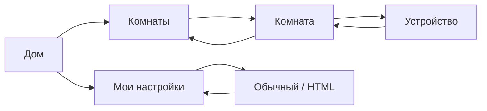

# Карта экранов и последовательный перенос

Дата: 6 ноября 2026 года. Правила оформления: [«Дом» 1.1](DESIGN.md), токены `1.0.0`.

Этот документ сопоставляет существующие Rust-экраны с предлагаемым оформлением. Раздел «Демонстрационный panel» описывает текущий ограниченный макет; остальные разделы задают последовательность переноса, а не утверждают, что весь бот уже работает через HTML. Реальный Home Assistant недоступен до отдельного сообщения владельца. Действия демонстрации изменяют только виртуальное устройство.

## 1. Общая навигация

«Назад» возвращает на предыдущий уровень, «Дом» — на главный экран. Возврат в список восстанавливает страницу. Обновление сохраняет выбранный раздел, фильтр, период графика и состояние разрешённого ввода. Переходы и смена вида используют маршрут просмотра, а не сохранённый action payload.

## 2. Демонстрационный panel

Состав: `panel.html` + `panel.css` + `panel.js`. Источник данных — `TelegramWidget.chatData`; в локальном preview его заменяет симулятор. Файлы не подключаются к HA самостоятельно и не содержат внешних ресурсов.

| Поле модели | Содержание |
|---|---|
| `v`, `rev` | Версия 1 и неотрицательная ревизия состояния |
| `screen` | `home`, `rooms`, `room`, `device` или `settings` |
| `eyebrow`, `title`, `description` | Контекст, заголовок и короткое пояснение |
| `hero` | `null` или `{label, value}` для основного значения |
| `items` | До четырёх `{label, detail, action, selected, primary}` |
| `nav` | До трёх `{label, action}` для возврата и разделов |

Допустимые действия: `home`, `rooms`, `room`, `device`, `settings`, `classic`, `html`, `on`, `off`, `read`. Запрос — `p1:<rev>:<action>`. ID комнаты и прибора определяются демонстрационным сервером; эта короткая схема не является универсальным протоколом для произвольного дома.

Ответ содержит `page` с новой моделью, `transition: true` при смене сообщения или `denied: true` при отказе. Страницы со старой ревизией не заменяют новые. Пересланный виджет скрывает исходные данные. После неопределённого результата изменения запрещены до успешного `read`; автоматического повторного включения/выключения нет.

### Соответствие существующим действиям

Это семантическое соответствие для будущего адаптера; перечисленные Rust-маршруты не вызываются самим демонстрационным panel.

| Действие panel | Существующий маршрут основного бота |
|---|---|
| `home` | `Payload::Home` |
| `rooms` | `ControlPayload::ListRooms` |
| `room` | `ControlPayload::RoomDetail { room }` |
| `device` | `ControlPayload::DeviceControl { room, device }` |
| `settings` | `PersonalPayload::Settings` |
| `on`, `off` | `ControlPayload::QuickAction` с `DeviceCmd::TurnOn` / `TurnOff`, через существующие проверки и подтверждения |
| `read` | Текущий безопасный маршрут просмотра; не повтор последнего изменения |
| `classic`, `html` | Новое предпочтение отображения; отдельная операция без физического действия |

## 3. Дом

Источник: [home.rs](../../src/bot/screens/home.rs).

**Сейчас:** до четырёх избранных, «Всё избранное», комнаты, сценарии, камеры, мои настройки, помощь; для владельца также админка. Избранное уже может содержать исполняемые действия, поэтому его перенос требует сохранить характер каждого пункта.

**Предлагаемое оформление:** заголовок «Мой дом», ниже группа избранного и компактные переходы к разделам. У каждого избранного элемента — явная подпись действия: «Открыть», «Включить», «Запустить». Основные входы не исчезают из-за ограничения четырёх строк: избранное выделяется в собственную страницу, остальные разделы распределяются по явно названным страницам меню. Счётчики комнат, включённых устройств или ошибок показываются только по актуальным данным с учётом прав.

В обычном виде улучшения достигаются группировкой текста и короткими подписями кнопок. В HTML те же действия становятся строками или компактными плитками; декоративные показатели и вымышленные «сценарии дня» не добавляются.

## 4. Комнаты

Источник: [rooms.rs](../../src/bot/screens/rooms.rs).

**Сейчас:** доступные комнаты, по 10 на странице, обновление, возврат и главное меню. Настройки комнат используют тот же список с другим назначением перехода.

**Предлагаемое оформление:** заголовок «Комнаты», до четырёх строк HTML-списка. Строка содержит имя комнаты и стрелку перехода; иконка комнаты вторична. Количество устройств допустимо только при наличии проверенного значения и не должно требовать отдельного HA-запроса ради декора. Нижний ряд — номер страницы и соседние страницы; ещё ниже возврат и обновление.

| Существующее действие | Отображение и сохранение поведения |
|---|---|
| `RoomDetail { room }` | Строка комнаты открывает её, ничего не включает |
| `RoomsPage { page }` | Явные кнопки страниц, без внутреннего скролла |
| Обновление | Текущая страница сохраняется и ограничивается доступным диапазоном |
| Нет доступных комнат | «Нет доступных комнат» и возврат; не бесконечный индикатор загрузки |

При разном размере страницы в обычном и HTML виде необходимо сохранять первый видимый ID либо индекс элемента и вычислять страницу нового представления. Один числовой номер страницы при размерах 10 и 4 не сохраняет позицию. В демо с одной комнатой это различие отсутствует.

## 5. Комната

Источник: [room.rs](../../src/bot/screens/room.rs).

**Сейчас:** строка света/выключателя при доступном управлении выполняет явный `TurnOn` или `TurnOff`; строка сенсора либо климата открывает карточку. Недоступные устройства остаются видимыми, скрытые и запрещённые фильтруются. Одинаковые имена различаются уточнением.

**Предлагаемое оформление:** название комнаты и отдельные строки устройств. Имя со значением открывает карточку. Для света и выключателя рядом размещается отдельное подписанное действие, например «Включить», с собственной целью не меньше 44 px. Таким образом пользователь может прочитать сведения об устройстве, не отправив команду случайным нажатием на имя. В обычном виде это две отдельные inline-кнопки на строку; в HTML — две отдельные цели внутри общего визуального блока. Нельзя вкладывать кнопку управления внутрь другой кнопки.

| Тип/состояние | Основная строка | Управление |
|---|---|---|
| Свет, выключатель | Имя + словесное состояние → карточка | Отдельная явная команда on/off |
| Сенсор | Имя + значение и единица → история | Физических команд нет |
| Климат | Имя + текущая температура → пульт | Изменение уставки в карточке |
| Недоступно | Имя + «Недоступен» → доступные сведения | Быстрое управление отсутствует |
| Только просмотр | Имя + состояние → карточка | Управление не предлагается |
| Критичное устройство | Как обычное, с краткой отметкой | Существующий этап подтверждения |

Логическая инверсия и пользовательские названия состояний остаются правилами backend. Дизайн не вычисляет команду из текста «Включён». Ошибка HA показывается один раз над списком; список известных доступных устройств не подменяется пустым экраном.

## 6. Устройство

Источники: [device_control.rs](../../src/bot/screens/control/device_control.rs), [climate_view.rs](../../src/bot/screens/control/climate_view.rs), [sensor_view.rs](../../src/bot/screens/control/sensor_view.rs), [personal.rs](../../src/bot/personal.rs).

### Свет и выключатель — первый перенос

Используется одобренная карточка: комната, имя, подтверждённое состояние, одно главное действие, результат, обновление и подробности. В реальном варианте сохраняются «Назад в комнату» и «Дом». В исходном `device_control.rs` карточка обычного света показывает сведения и обновление, а быстрые команды находятся в комнате; добавление главного действия в карточку переиспользует уже существующий `QuickAction`, а не создаёт новый обход проверки доступа.

Включение и выключение передают конкретное желаемое состояние. Ответ «команда отправлена» не превращает показание в «Включён»: подтверждённое состояние поступает отдельным ответом/событием. После ошибки с неизвестным результатом доступно обновление, но не автоматический повтор. Критичное действие показывает конкретную цель, команду и срок подтверждения.

### Климат — следующий перенос

Два значения: «Сейчас» и «Уставка». Режим выводится словом. Кнопки минус/плюс используют действительный шаг и диапазон HA. `AdjustTemp` и `SetTemp` сохраняют существующую очередь и проверку прав. Обновление и вход в карточку не посылают команд.

Точная температура вводится через существующий диалог Telegram либо отдельный компактный выбор с подтверждением: стандартного HTML-поля в виджете нет. Переключение режима климата не следует рисовать до появления соответствующего backend-действия; текущий экран его отображает, но не предлагает менять. Режим диапазона температур продолжает работать в пределах существующих возможностей.

### Сенсор и история — отдельный этап

Крупное текущее значение с единицей, график, выбранный период и обе границы времени. Сохраняются пресеты 12 ч / 24 ч / 3 д / 7 д, сдвиг по датам и ручной интервал 1–240 ч. Ручной ввод пока остаётся диалогом Telegram. Интерактивный график потребует отдельного компактного набора данных; до реализации формат графика можно оставить обычным изображением, сохранив выбранный вид для остальных экранов.

Подробности показывают HA-идентификатор и диагностические данные только пользователю с правом просмотра. Длинный текст не встраивается целиком в ограниченный по высоте виджет.

## 7. Мои настройки

Источник: [personal.rs](../../src/bot/personal.rs), `PersonalPayload::Settings`.

Рекомендуется разделить настройки на короткие страницы, сохранив все текущие функции:

| Группа | Представление | Существующее/новое действие |
|---|---|---|
| Вид интерфейса | Два варианта «Обычный» / «HTML», выбранный с ✓ | Новое персональное предпочтение |
| Язык | «Русский» / «English», выбранный явно отмечен | `Language { english }` |
| Тихие часы | Состояние, интервал и часовой пояс; отдельное действие включения | `Quiet { enabled }` |
| Интервал | Кнопка «Изменить интервал» → существующий ввод | `QuietInput` |
| Уведомления | Переход к доступным устройствам и личным подпискам | `Notifications`, `Subscription`, `SetSubscription` |
| Избранное | Список, поднять первым, удалить, открыть | `Favorites`, `FirstFavorite`, `RemoveFavorite` |

Сохранение интервала не включает тихие часы. Критические уведомления приходят независимо от тихих часов; эта короткая подсказка остаётся рядом с настройкой. Запрет администратора на уведомления различается от пользовательского выключения подписки. Настройки уведомлений сохраняются независимо от доступности HA.

В выборе вида не показываются «HTML включён» и «Обычный включён» одновременно. Повторное нажатие выбранного варианта не заменяет сообщение. При недоступности HTML пользователь получает короткое объяснение и рабочий обычный экран.

## 8. Порядок переноса и приёмка

| Этап | Результат | Проверка |
|---|---|---|
| 1. Демо-навигация | Дом → Комнаты → Гостиная → Торшер; Настройки; обычный/HTML вид одной модели | Без HA, одинаковое виртуальное состояние в обоих видах |
| 2. Реальные настройки и маршруты | Персональное предпочтение, fallback для неподдержанных страниц, сохранение позиции | Перезапуск, смена вида, возврат, отзыв допуска |
| 3. Реальный свет/выключатель | Карточка использует существующие ACL, подтверждения и журнал | Только после сообщения владельца о доступе к HA |
| 4. Климат и сенсоры | Пульт с диапазонами/шагом, история с сохранением периода | Проверка команд, отмены загрузки и прав просмотра |
| 5. Остальные разделы | Камеры, сценарии, архив, админка по отдельным задачам | Сохранение всех действий и ограничений каждого раздела |

Камеры, сценарии и администрирование остаются доступными в основном боте во время переноса. Самостоятельное исчезновение их входов под видом упрощения дизайна недопустимо.

Критерии для каждой перенесённой страницы:

- Светлая/тёмная тема, ширина 200, 320, 360 и 430 px; высота не выше 600 px.
- Длинные названия не выталкивают управление; пустые и недоступные данные имеют явное состояние.
- Имена и значения вставляются текстом; отозванный доступ убирает данные предыдущего экрана.
- Обычный и HTML вид предлагают одинаковые поддержанные действия с одинаковыми правами.
- Переключение вида, обновление и возврат не отправляют физические команды.
- Старые сообщения и ответы не восстанавливают ушедший экран и не повторяют действие.
- HTML-артефакт укладывается в лимиты Telegram и не загружает внешние ресурсы.
- Локальный успешный тест не объявляется проверкой реальных Telegram-клиентов или Home Assistant.
