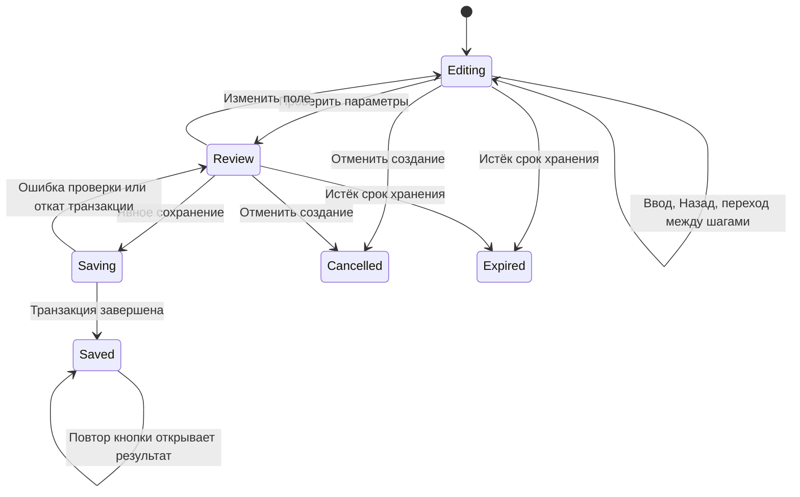
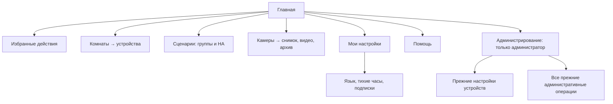

# Спецификация: улучшение интерфейса Telegram HA Bot без потери функций

| Поле | Значение |
|---|---|
| Версия | 1.0 |
| Дата | 2026-09-29 |
| Основание | UX-ревью экранов, маршрутов и обработчиков в текущем репозитории |
| Базовая ревизия | `ef94880` |
| Статус | Спецификация подготовлена; требования ещё не реализованы и не приняты |
| Аудитория | Разработчик, тестировщик, владелец бота |

## 1. Цель и границы

Устранить потерю настроек при навигации, недостоверное представление истории,
неожиданную активацию расписаний и недостаточную обратную связь. Сократить путь
к частым действиям, открыть собственные настройки пользователям и уменьшить
плотность служебной информации, сохранив возможности управления домом.

Основание — анализ кода, а не пользовательское исследование или проверка
мобильных скриншотов. Потери данных и переходы подтверждены реализацией;
влияние высоты фонового изображения на удобство требует проверки на устройствах.

В объём входят девять проблем ревью, единые подписи и представление технических
данных. Предлагаемые новые функции: избранное, личные настройки, уточнение
неоднозначной команды кнопками и точный ввод температуры.

Архитектура остаётся Telegram-ботом с inline-кнопками, SQLite и существующими
интеграциями Home Assistant/камер. Telegram Mini App, отдельный веб-интерфейс,
редактор автоматизаций HA и новые типы управления устройствами в объём не входят.

В документе **Must** означает обязательную часть завершённого решения,
**Should** — улучшение, допускающее отдельную поставку. P1/P2 задают порядок:
P1 влияет на результат действия и доверие, P2 — на доступность и удобство.

## 2. Контракт сохранения функциональности

### 2.1. Общие инварианты

- **INV-01.** Каждая существующая пользовательская и административная операция
  остаётся доступна пользователю с теми же правами. Переименование или перенос
  кнопки допускается; исчезновение операции — нет.
- **INV-02.** Просмотр, обновление, перелистывание, восстановление сессии и
  возвращение назад не отправляют команды устройствам и не сохраняют черновик
  как действующее правило/расписание.
- **INV-03.** Новые пути используют существующие проверки ACL, критичности,
  актуальности объекта и подтверждения. Избранное и личные настройки не дают
  дополнительных административных разрешений.
- **INV-04.** Действующие правила, расписания, подписки, алиасы, инверсия,
  настройки камер, конфигурация и файлы архива сохраняются при обновлении.
- **INV-05.** Новые callback-варианты добавляются в конец сериализуемых enum.
  Порядок и поля существующих вариантов `Payload` и вложенных enum не меняются:
  кодирование использует postcard/base64. Старые JSON-состояния и сохранённые
  контексты либо читаются совместимо, либо получают безопасный адаптер.
- **INV-06.** `for_refresh()` для новой мутации возвращает маршрут чтения.
  Старые callback не могут создать новый объект или повторить уже выполненную
  команду при обновлении экрана. Истёкший контекст объясняется пользователю.
- **INV-07.** Сохраняются ru/en, ограничения Telegram, текстовая пагинация,
  фон, явные изображения, отмена устаревших перерисовок, обработка rate limit
  и восстановление сессий. Повтор Telegram-запроса не повторяет HA-команду.
- **INV-08.** «Команда отправлена» означает успешную передачу в HA, а не
  подтверждённое физическое изменение. Неопределённый результат не считается
  ни успехом, ни доказанным отсутствием воздействия.

### 2.2. Обязательная регрессия возможностей

| Область | Что должно сохраниться | Проверка |
|---|---|---|
| Комнаты и устройства | Списки, видимость, страницы, прямые команды света/выключателей, доступ только для просмотра, недоступные устройства | Root, user, child, guest; возврат, отзыв прав, сбой HA |
| Климат | Уставка, текущая температура, режим, границы, шаг, очередь абсолютных/относительных команд | Очередь и подтверждения, включая задержку состояний HA |
| История | Пресеты, ручной диапазон 1–240 ч, смещение, повторное открытие, единицы и даты | Те же периоды и переходы; исправленное отображение отсутствия данных |
| Настройки устройств | Имена, HA-имена, алиасы состояний, инверсия, видимость, критичность и подписки | Старые значения и все административные операции доступны |
| Текст и голос | Существующий синтаксис, tolerant matching, STT, три voice engine, TTL подтверждений | Корпус поддерживаемых команд для каждого режима |
| Группы действий | Состав, фильтры, страницы, включение/выключение, доступ, локальные группы, HA scripts/scenes и расписания | Ручное выполнение и существующий scheduler |
| Камеры | Добавление, снимок, короткое видео с выбранной длительностью, превью, диагностика | Медиасценарии и отказы на стенде |
| Архив | Все фильтры, страницы, доступные части и отправка всех частей, сжатие, закрепление, остановка и подтверждение удаления | Полная, активная и частично повреждённая запись |
| Событийная запись | Мастер и текстовый ввод, операторы, any/all, группы, время активности, дни, cooldown, retention, сегменты, pre-roll | Существующие правила и новые правила с теми же параметрами |
| Уведомления | Подписки, административный запрет уведомлений, тихие часы, исключение для критических событий | Доставка с существующими ACL и расписаниями |
| Эксплуатация | Синхронизация HA, пользователи, права, журнал, диагностика, фон, восстановление и существующие операции с БД | Достижимость прежних экранов и сравнение данных |
| Конфигурация и хранение | Старый options.json, ENV, SQLite и пути архива | Запуск на копии существующей БД без обязательных новых настроек |

Матрица не заменяет инвентаризацию: до изменения меню исполнитель фиксирует
все действующие административные кнопки и их новые пути. Каждая должна
попасть в приёмочный чек-лист. Успешная сборка сама по себе не доказывает
сохранение функциональности.

## 3. Трассировка проблем

Ссылки ниже относятся к исходным модулям базовой ревизии; точные номера строк
после реализации могут измениться.

| ID | Проблема / результат | Приоритет | Основные модули |
|---|---|---|---|
| UX-01 | Мастер сохраняет данные при возврате и переходе в текстовый режим | P1 / Must | [wizard](../../src/bot/recording_rule_wizard.rs), [экраны администратора](../../src/bot/screens/admin/list_actions.rs), [router](../../src/bot/router.rs) |
| UX-02 | История отличает реальные значения от отсутствия данных | P1 / Must | [charts](../../src/charts/mod.rs), [HA history](../../src/ha/client.rs), [sensor_view](../../src/bot/screens/control/sensor_view.rs) |
| UX-03 | Расписание включается только после проверки параметров | P1 / Must | [handlers](../../src/bot/handlers.rs), [action_groups UI](../../src/bot/screens/action_groups.rs), [scheduler](../../src/core/action_schedules.rs) |
| UX-04 | Непонятный ввод получает ответ; неоднозначность уточняется | P1 / Must | [text_commands](../../src/bot/text_commands.rs), [commands](../../src/core/commands.rs), [bot schema](../../src/bot/mod.rs) |
| UX-05 | Частичное выполнение показывает фактические результаты отправки | P1 / Must | [confirmations](../../src/bot/confirmations.rs), [группы](../../src/core/action_groups.rs), [UI-подтверждения](../../src/db/ui_confirmations.rs), [text/voice pending](../../src/db/pending_commands.rs) |
| UX-06 | Пользователь управляет своими предпочтениями и подписками | P2 / Must | [настройки устройств](../../src/bot/screens/settings/device_settings.rs), [subscriptions](../../src/db/subscriptions.rs), [quiet hours](../../src/db/user_notification_schedule.rs) |
| UX-07 | Главная даёт быстрые действия и понятную структуру | P2 / Must | [home](../../src/bot/screens/home.rs), [common](../../src/bot/screens/common.rs), [i18n](../../src/i18n.rs) |
| UX-08 | Фильтры архива не вытесняют записи | P2 / Must | [cameras](../../src/bot/screens/cameras.rs) |
| UX-09 | Есть точный ввод температуры без потери управления шагами | P2 / Must | [climate_view](../../src/bot/screens/control/climate_view.rs), [очередь климата](../../src/core/climate_control.rs) |
| UX-10 | Единые подписи, подробности и понятный выбор пользователя | P2 / Must | [i18n](../../src/i18n.rs), [admin UI](../../src/bot/screens/admin/list_actions.rs), [View](../../src/bot/models.rs) |
| UX-11 | Проверена высота меню; медиа сохраняются при длинном тексте | P2 / Must для проверки и медиа; Should для компактного режима | [отрисовка](../../src/bot/handlers.rs), [фон](../../src/core/ui_background.rs) |

## 4. Функциональные требования и приёмка

### UX-01. Единый черновик правила записи

**FR-01.1.** Навигация и отрисовка читают черновик без изменения полей.
Повторный выбор текущего датчика/камеры не запускает сброс.

**FR-01.2.** Черновик содержит все данные, необходимые для создания:
комнату, камеру, источник и режим, порог, полный список условий, any/all,
название, длительность после события, длину сегмента, cooldown, хранение,
время активности и дни, группы, pre-roll. Для автоматически назначаемых
названия, логики и cooldown хранится признак ручного изменения.
Также сохраняются шаг, источник перехода и незавершённый текстовый ввод.

**FR-01.3.** Допустимые изменения зависимых полей:

| Фактическое изменение | Что меняется | Что сохраняется |
|---|---|---|
| Источник события | Режим и порог требуют повторного выбора | Дополнительные условия, группы, расписание и параметры записи |
| Выше ↔ ниже для того же источника | Оператор | Введённое числовое значение |
| Числовой режим → нечисловой | Убирается неиспользуемый порог | Остальные поля |
| Камера в той же комнате | Камера | Остальные параметры с повторной валидацией |
| Комната | Повторная проверка камеры и ссылок | Допустимые источники из других комнат не удаляются |
| Оператор дополнительного условия | Только несовместимые поля этого условия | Остальные условия и настройки |

Автоматические поля пересчитываются только пока пользователь их не переопределил.
Удалённая/недоступная сущность помечается как требующая исправления; остальные
данные черновика сохраняются.

**FR-01.4.** «Назад» из групп возвращает к времени активности при линейном
прохождении и к сводке при редактировании из сводки. «Готово» ведёт к сводке.
Выход в главное меню оставляет черновик; «Отменить создание» отменяет только его.
При следующем входе доступны «Продолжить» и явное создание нового черновика.

**FR-01.5.** «Редактировать текстом» из мастера редактирует тот же черновик.
Отправленный корректный блок возвращает к сводке, не создавая правило.
Отсутствующие в старом формате поля сохраняются из черновика. Ошибка разбора
не меняет валидные поля, сохраняет введённый текст и объясняет строку/поле ошибки.
Произвольный допустимый набор условий отображается как «Пользовательские условия»
и не сокращается до одного события при возврате в мастер.

**FR-01.6.** Сохранить старый текстовый формат: порядок строк, any/all и
поддерживаемые синонимы, операторы, пустые значения, `*`, извлечение блока из
карточки. Независимый текстовый ввод продолжает создавать правило по прежним
значениям по умолчанию. Редактирование существующего правила сохраняет поля,
которых нет в блоке: группы, расписание, pre-roll, уведомления, шумоподавление
и enabled. Новый обязательный формат не вводится.

**FR-01.7.** Кнопка «Создать правило» сохраняет правило, условия, группы и
расписание одной транзакцией после повторной проверки ссылок и прав.
Один черновик создаёт не более одного правила; повтор submit открывает результат.
Похожее существующее правило не заменяет создаваемое молча: показать различия
и оставить возможность явно создать отдельное правило с отличающимися параметрами.

**AC-01:** заполненный черновик проходит все шаги назад/вперёд, обновление,
«мастер → текст → сводка» и перезапуск без потери полей. При изменении источника
меняются только зависимости из таблицы. Отправка неизменённого текстового блока
сохраняет ночное расписание и выбранные группы. Двойное создание даёт один ID;
ошибка БД не оставляет частичного правила. Старые текстовые примеры продолжают
разбираться с прежним смыслом.

### UX-02. Достоверная история датчиков

**FR-02.1.** Числовые интервалы `unknown`, `unavailable`, нечисловые значения
и NaN/±Inf обозначаются как «Нет данных» и разрывают линию. Бинарная история
различает активное, неактивное и неизвестное состояние; неизвестное не равно OFF.

**FR-02.2.** Сохранить ступенчатую модель событий HA: известное историческое
значение действует до следующего события. Длительное отсутствие изменений само
по себе не считается отказом. Начало периода без подтверждённого исторического
значения неизвестно; последнее известное значение продолжается до конца периода,
если за ним не было события недоступности.

**FR-02.3.** Пустую историю запрещено заполнять текущим `/api/states` задним
числом. Отображается «Нет данных за выбранный период». Допустима начальная точка
из подтверждённого исторического состояния на границе периода или до неё.
Это требует проверки получения истории в HAClient, а не только рисунка.

**FR-02.4.** Легенда, текущая подпись и бинарная история используют одну
семантику класса датчика, инверсии и алиасов. Неизвестные значения не инвертируются.
Состояния различаются текстом и рисунком/штриховкой, а не только цветом.
Сырые события и хранимые алиасы не переписываются.

**AC-02:** `[20, unavailable, 22]` имеет разрыв; `[off, unavailable, on]` — три
различимых участка. Пустая история за прошлую неделю остаётся пустой независимо
от текущего состояния. Проверены весь период без данных, неизвестное начало,
одно постоянное значение, события на границах, инверсия двери и пользовательские
названия. Пресеты, 1–240 ч, смещение, единицы, обновление и возврат сохранены.

### UX-03. Настройка расписания до активации

**FR-03.1.** Создание: действие → время → дни → сводка → «Включить расписание»
или «Сохранить выключенным». До последнего шага данные находятся в отдельном
черновике и не участвуют в выборке scheduler. Ввод времени ничего не активирует.

**FR-03.2.** Сводка содержит цель, конкретную команду, дни, время, фактический
часовой пояс планировщика и ближайший расчётный запуск. Для базовой поставки
сохраняется серверное время scheduler; личный часовой пояс не переносит расписания.
Если имя зоны недоступно, показать «Время сервера» и текущий UTC offset; не выдавать
фиксированный offset за правило перехода на летнее время.

**FR-03.3.** Сохранить группы с turn_on/turn_off и HA script/scene с execute,
время 00:00–23:59 и минимум один день. Удалённая/архивная цель или отсутствие
прав блокируют активацию с сохранением черновика. Временный HA offline сам
по себе не запрещает сохранить или включить расписание для допустимой цели
из БД: показать предупреждение, а исполнение оставить действующему scheduler.
Дни могут по умолчанию быть «Каждый день»,
но этот выбор виден до активации.

**FR-03.4.** Редактирование существующего расписания идёт в копии; действующая
версия работает до «Сохранить изменения». Это явно подписано. Отмена не меняет
старое расписание. Сохранение атомарно проверяет версию; конкурентное изменение
не перезаписывается молча. Отдельная существующая пауза расписания сохраняется.

**FR-03.5.** Повтор submit не создаёт дубликат и не повторяет активацию.
Сохранить enabled, last_run_at, дни, время и команды существующих расписаний.
Отображение ближайшего запуска соответствует прежнему алгоритму scheduler,
включая текущую минуту; не добавлять скрытый немедленный запуск или догон пропусков.

**AC-03:** тик scheduler между вводом времени и выбором дней не вызывает HA;
отмена не создаёт активного расписания; двойной submit создаёт одну запись.
Перезапуск не активирует черновик. Старое расписание исполняется по прежним
правилам, редактируемое меняется только после сохранения; конфликт версий объяснён.

### Общий жизненный цикл черновика

Схема применяется к мастеру правила и созданию/редактированию расписания.
Она не меняет жизненный цикл старых голосовых pending-команд.



### UX-04. Обратная связь и уточнение ввода

**FR-04.1.** Для авторизованного пользователя в Idle неподдержанный текст
получает ответ: «Не понял команду. Например: включи свет в кухне или снимок вход»
с «Выбрать устройство», «Помощь», «В меню». Исходный текст с ошибкой не удаляется
до возможности его исправить. Уже успешные команды могут очищаться по прежней
политике. Активные формы продолжают получать свой ввод раньше общей подсказки.

**FR-04.2.** Различать «не команда», «не найдена цель», «нужно уточнение» и
«ошибка выполнения». Для локальной неоднозначности показывать доступные варианты
«Комната · Устройство» / «Комната · Камера», по 10 на страницу, и отмену.
Пользователь выбирает стабильный ID; названия не используются как идентификаторы.

**FR-04.3.** Контекст уточнения сохраняет исходное действие, текст, источник,
voice engine, длительность видео и уже распознанные части. До разрешения локальной
неоднозначности ни одна часть этой команды не исполняется. Истинные массовые
команды вроде «весь свет» не превращаются в выбор одного устройства.
Выбор критичной цели ведёт в существующее подтверждение.

**FR-04.4.** Уточнение принадлежит текущему пользователю, действует 120 секунд
и завершается однократно. Отзыв доступа/удаление кандидата проверяется при выборе.
Новая команда закрывает устаревший выбор; старые кнопки предлагают повторить ввод.
Выбор цели не продлевает TTL уже созданных подтверждений.

**FR-04.5.** Сохранить различия voice engine: LocalParser — локальный разбор;
Readonly — прежние локальные команды камер, затем распознавание и чтение;
Full — прежние локальные команды камер, затем HA conversation с локальным
fallback при достоверно известном отсутствии воздействия. Текущий безусловный
fallback после любой ошибки уточняется: таймаут/потеря ответа после возможной
отправки дают unknown, без второй попытки через локальный исполнитель.
HTTP-ошибка сама по себе не доказывает отсутствие воздействия. Поддержанные
локальные команды и fallback до отправки в HA сохраняются.
Уточнение не превращает Readonly в управляющий режим. Несколько целей
в агрегирующем вопросе Readonly не считаются ошибкой. Если HA Full не возвращает
структурированные кандидаты, показать ответ HA и предложить переформулировать;
не придумывать варианты и не добавлять повторное исполнение через другой путь.

**FR-04.6.** Добавить `/help`, `/cancel` и кнопку помощи. `/cancel` отменяет
ожидаемый ввод текущего поля или выбор цели с возвратом в исходный экран;
сохранённые поля черновика остаются. Весь черновик отменяет только явное
«Отменить создание». Уже принятая HA-команда не отменяется. `/start` сохраняет
смысл возврата на главную, не активирует черновики; незавершённый черновик
доступен для продолжения.

**FR-04.7.** Голосовой статус относится к конкретному запросу и меняется по
этапам «Распознаю» → «Обрабатываю» → результат/ошибка. При завершении убрать
или заменить прогресс сразу, не оставляя «Распознаю» до истечения таймера.
Таймер очистки остаётся резервом на случай сбоя. Поздний ответ старого запроса
не изменяет статус нового и не перекрывает выбранный пользователем экран.

**AC-04:** непонятный текст даёт ответ; две доступные лампы дают две различимые
кнопки без HA-вызова до выбора. Не раскрываются скрытые устройства. После выбора
сохраняются действие и длительность видео. Чужой, повторный и истёкший callback
не исполняет команду. Ввод имени камеры в активной форме не перехватывается.
Корпус старых команд ru/en, ID камер, fuzzy matching, массовых запросов и трёх
voice engine проходит регрессию; Readonly не выполняет write-вызовы. Для Full
проверены отказ до отправки с доступным fallback и потеря ответа после отправки
без второго воздействия. Это намеренное исправление повтора, а не удаление
поддержки локальных команд.
При быстром распознавании одновременно не остаются итог команды и активный
статус её распознавания; ошибка STT также завершает прогресс.

### UX-05. Результат массовой команды

**FR-05.1.** Сохранять структурированный результат по целям и общий outcome:
`sent`, `partial`, `failed`, `unknown`. Для каждой цели — стабильный ID, результат
отправки, краткая причина и время. Сохранять также читаемый result_text для
совместимости и открытия результата после перезапуска.

| Outcome | Пользовательское сообщение | Доступное продолжение |
|---|---|---|
| sent | «Команды отправлены 10 из 10. Ожидается обновление состояний» | Проверить состояния |
| partial | «Команды отправлены 9 из 10», список оставшихся и причины | Открыть состояние каждой доступной цели |
| failed | «Команды не отправлены», конкретные известные причины | Проверить состояния / вернуться |
| unknown | «Результат отправки не удалось определить» | Сначала проверить состояние |

`failed` применяется только при известном отказе; потеря ответа после возможной
отправки относится к unknown. Смешанный результат показывает отдельно числа
успешных отправок, известных отказов и неизвестных исходов. Неизвестную цель
нельзя включать в число доказанно неисполненных.

**FR-05.2.** Повторное открытие, refresh и пагинация читают сохранённый
результат, не выполняя команду. Область — кнопочные группы и подтверждённые
локальные text/voice-команды, включая исполняемые HA-native действия.
Атомарный claim `ui_confirmations` до HA-вызовов сохраняется. Для отдельного
хранилища `pending_commands`, где сейчас исполнение предшествует пометке,
добавить условный переход `pending → confirmed` по owner и expires_at до первого
воздействия; после него хранить terminal status и структурированный результат.
Повтор/перезапуск не переводит confirmed/executed/failed обратно в pending.
Существующие ID, intent_json, source и TTL pending-команд сохраняются.
Таймаут/перезапуск после claim не дают автоматического повтора. Если подтвердить
исход невозможно, отображается unknown. Exactly-once физического воздействия
между SQLite и HA не обещается.

**FR-05.3.** Не добавлять общий автоматический повтор группы. При ручной новой
команде действуют прежние ACL и подтверждения. Имена и переходы в сохранённом
результате фильтруются по текущему доступу; отозванная цель обозначается без
раскрытия недоступных подробностей. Технические ошибки не раскрывают токены/URL.

**FR-05.4.** В пользовательской карточке группы доступен весь разрешённый
состав через «Устройства» с пагинацией, включая группы более 12 элементов.
Перед массовым критичным действием показать конкретную команду, число целей
и доступные критичные устройства; длинный список открывается целиком.
Просмотр состава не открывает пользователю редактор и не меняет группу.

**AC-05:** один отказ из десяти показывает 9/10 и проблемную цель; результат
сохраняется после refresh и перезапуска. Повтор callback не вызывает HA повторно.
Потеря ответа после отправки показывает unknown. Отозванные права учитываются
при чтении результата. Проверены оба хранилища подтверждений: UI и text/voice,
конкурентный claim и старые pending-записи. Группа из 20 устройств доступна
для полного просмотра без выдачи прав редактирования.

### UX-06. Личные настройки без изменения прав

**FR-06.1.** Всем авторизованным пользователям доступен отдельный маршрут
«Мои настройки»: язык ru/en, тихие часы и «Мои уведомления». Объект изменения —
только текущий Telegram user_id; переданный клиентом чужой ID не принимается.
Существующий admin-only маршрут настроек устройств не открывается всем.

**FR-06.2.** «Мои уведомления» и карточка устройства дают явные действия
«Включить уведомления» / «Выключить уведомления». Повтор одного действия
идемпотентен. Включение требует текущего просмотра и can_notify; настройка
подписки не меняет административный can_notify, can_control или видимость.
Политика root и иерархия ACL сохраняются.

**FR-06.3.** Настройки подписки и их сохранение работают из SQLite при
недоступном HA. Статус устройства при этом обозначается как недоступный;
ошибка загрузки состояния не отменяет успешное сохранение предпочтения.
Отзыв прав продолжает блокировать доставку даже при сохранившейся подписке.

**FR-06.4.** Для тихих часов доступны включение, выключение и изменение
интервала HH:MM–HH:MM. Отсутствие записи означает выключенные тихие часы,
как сейчас. Пресет 23:00–07:00 предлагается при первом явном включении;
открытие формы и изменение интервала сами его не включают.
Ночной интервал поддерживается, равные начало/конец отвергаются
как неоднозначные. Существующий timezone сохраняется, его фактическое значение
видно пользователю; при NULL показано время сервера. Новая политика часовых
поясов не вводится. Критические уведомления сохраняют действующее исключение.

**FR-06.5.** Администратор сохраняет управление пользователями, ограничениями
уведомлений, голосовыми разрешениями и engine. Пользователь не может сам менять
свою роль, разрешение на голос или назначенный движок. Действие администратора
и личное предпочтение не объединяются в одну настройку.

**AC-06:** два пользователя независимо меняют подписку и язык. Запрет can_notify,
отзыв просмотра, скрытая комната и архивирование продолжают блокировать доставку.
Подмена user_id не меняет чужие данные. HA offline не блокирует сохранение
подписки; повторное включение не дублирует запись. Проверены ночные тихие часы,
критические события и существующие значения timezone. Для пользователя без
настроек открытие/редактирование интервала не меняет доставку уведомлений.

### UX-07. Главная и избранное

**FR-07.1.** Целевые разделы: «Комнаты», «Сценарии», «Камеры», «Мои настройки»,
«Помощь»; у администратора дополнительно «Администрирование».
«Сценарии» — понятное название существующих групп действий и HA scripts/scenes,
без объединения их с группами правил записи. Прежние настройки устройств
переезжают в «Администрирование → Устройства». Старые маршруты остаются рабочими.

**FR-07.2.** Над разделами показывать до четырёх выбранных пользователем
избранных элементов. Остальные доступны через «Всё избранное» с пагинацией.
Добавление/удаление и порядок персональные; существующая установка начинает
с пустого избранного. В отсутствие элементов показать короткую подсказку,
не заменяя ею существующий статус и предупреждения.

**FR-07.3.** Поддержать ярлыки карточек устройств/камер и существующих
пользовательских команд света, выключателей, групп, HA script/scene и снимка.
Командные ярлыки хранят конкретное действие, не неоднозначный toggle.
Критичность не отменяется: одно нажатие открывает подтверждение, если оно нужно.
Запрещённая после отзыва доступа цель не раскрывается и не исполняется.
Недоступная в HA, но разрешённая цель остаётся с понятным статусом.

**FR-07.4.** С главной обычное избранное действие требует одного нажатия,
критичное — нажатия и существующего подтверждения. Путь через комнаты остаётся
доступным. Добавление в избранное само ничего не исполняет.
В помощи привести примеры текстового управления и голосовой команды; если голос
выключен для пользователя, объяснить это без предложения самостоятельно выдать доступ.

**AC-07:** прежние разделы и все их операции достижимы; управление светом через
комнаты сохранено. Избранное переживает перезапуск, отдельно для двух пользователей,
не обходит запреты и критичные подтверждения. Длинные названия и одинаковые имена
различимы комнатой; никакое сокращение подписи не меняет цель действия.



### UX-08. Архив и фильтры

**FR-08.1.** До списка записей показывать одну строку кнопок «Сегодня», «Все»,
«Фильтры» и текст текущего фильтра. Полный набор вынести в отдельный экран:
все, сегодня, 7 дней, готовые, ошибки, закреплённые, правило. Сохранить прежнюю
семантику и взаимную исключительность фильтров; их комбинирование не вводится.

**FR-08.2.** Правила выбирать отдельным списком по 10 на страницу. Полное
название выбранного правила показывается в тексте. Совпадающие или обрезанные
названия различаются дополнительным устойчивым обозначением; полный вариант
можно прочитать до применения. Нельзя ограничить доступ первыми N правилами.

**FR-08.3.** Выбор нового фильтра начинает с первой страницы. «Назад» из выбора
фильтра без применения сохраняет прежний контекст; из записи — возвращает к
тому же фильтру и странице. Удаление записи/правила корректирует недоступную
страницу или предлагает сброс с объяснением. На каждом переходе проверяется доступ.

**FR-08.4.** Подпись «Показано: N» относится к текущей странице. «Всего: N»
допускается только при реальном подсчёте результата. Пустой список называет
активный фильтр и предлагает «Показать все». Операции самой записи сохраняются.

**AC-08:** при 30 правилах до первой записи остаётся одна строка фильтров;
все правила доступны через страницы. Возврат из записи со второй страницы
сохраняет контекст, смена фильтра сбрасывает страницу. Проверены пустой результат,
удаление последней записи страницы, отзыв доступа, закрепление, отправка частей,
остановка и удаление с подтверждением.

### UX-09. Точная температура

**FR-09.1.** При поддерживаемой регулировке добавить «Задать температуру»,
сохранив ±. Диалог показывает имя, комнату, текущую уставку, единицу, пределы
и шаг; принимает десятичную точку и запятую, отвергает нечисловые/non-finite
значения. Ошибка оставляет ввод открытым; отмена возвращает карточку без команды.

**FR-09.2.** Ввод переводится в существующий `DeviceCmd::SetTemp` и общую
очередь TemperatureCommand::Set. Не добавлять прямой HA-вызов в обработчик текста.
Сохранить порядок абсолютных и относительных команд, ограничение очереди,
обработку запаздывающего HA и неопределённого результата.

**FR-09.3.** Доступ, поддерживаемый режим, актуальные границы и критичность
повторно проверяются при исполнении. Критичная цель проходит существующее
подтверждение с точной температурой и TTL 120 секунд. Readonly-пользователь
не получает ввод уставки. Режимы, которые сейчас поддерживают только просмотр,
не начинают исполнять новые команды.

**FR-09.4.** Шаг определяет кнопки ±. Текущий SetTemp не проверяет кратность
шагу: эта спецификация не вводит новое глобальное ограничение и не округляет
введённую цель молча. Ответ показывает «Запрошена температура…»; уход с экрана
отменяет устаревшую перерисовку, а не уже принятую команду.

**AC-09:** ввод `18`, `18.5`, `18,5` даёт соответствующую цель. Ошибка/отмена
не вызывает HA. `Set(20)` затем `Step(+1)` при шаге 0,5 отправляет 20 и 20,5
по очереди. Отзыв прав или изменение границ перед исполнением блокирует команду.
Повторное, чужое и просроченное подтверждение не добавляет HA-вызовов.

### UX-10. Подписи, подробности и пользователи

**FR-10.1.** Использовать единый словарь ru/en: «Диагностика / Diagnostics»
вместо Health, «Запись до события / Pre-event recording» вместо Pre-roll,
«Редактировать текстом / Edit as text» вместо raw-блока, «Обработка голоса /
Voice processing» вместо Engine. Технические значения сохраняются в подробностях
и конфигурации; переименование не меняет enum, API или формат импорта.

**FR-10.2.** Основная карточка показывает название, комнату, состояние,
существенное предупреждение и основные действия. Entity ID, исходные значения
HA, служебные параметры и диагностика доступны через «Подробности»/«Настроить».
Они не удаляются. Причина паузы правила, время кадра, ошибка и результат команды
остаются на основном экране. Состояние устройства в управлении и настройках
использует одну семантику единиц, инверсии и алиасов.

**FR-10.3.** Список пользователей показывает сохранённый псевдоним либо имя
из доступных Telegram updates и роль. ID виден в профиле; при одинаковых именах
на кнопке есть различающее обозначение. Для ID, по которому имя ещё неизвестно,
сохранить fallback «Пользователь #ID» и возможность администратору задать псевдоним.
Поиск людей во внешних сервисах не требуется. Выбор/удаление всегда адресуется ID.

**FR-10.4.** Общая модель экрана: заголовок/контекст → важное состояние и
результат → основной контент → действия → навигация. Успех, ошибка и ожидание
не различаются только emoji или цветом. Длинные подробности используют существующую
пагинацию; данные не обрезаются без способа открыть полный текст.

**AC-10:** все прежние технические сведения доступны в подробностях, критичные
предупреждения видны сразу. Проверены ru/en, одинаковые имена, пользователь без
известного имени и переименование без смены ID. Старые операции администратора
достижимы, формат текстовых правил и конфигурации не изменён.

### UX-11. Высота меню и необязательный компактный режим

**FR-11.1 (Must для проверки).** На мобильных клиентах проверить главную,
комнату с 10 устройствами, климат и архив с длинными названиями: определить,
сколько прокруток требуется до первого основного действия, различимы ли подписи,
не теряются ли предупреждения. Результат фиксировать скриншотами без секретов.
Не объявлять проблему фона доказанной только по коду отправки фото.

**FR-11.2 (Should).** Допускается персональный режим «Компактное меню».
По умолчанию сохраняется существующий фон и его настройка. Компактный режим
может убирать только декоративный фон; графики, снимки и видео остаются доступны.
Возврат в обычный режим восстанавливает выбранный фон, включая камеру.

**FR-11.3 (Must).** Независимо от режима график, снимок и другое явное медиа
не теряются из-за длинного текста. Если они не помещаются вместе, текст выносится
на страницы с сохранённым доступом к медиа, а не заменяет его.

**AC-11:** в обычном режиме сохраняется выбранный фон; график с подписью сверх
лимита остаётся доступен целиком. Проверены переходы «фон → график → снимок →
длинный текст → фон», отмена загрузки, 429, статус и предупреждения; при
реализации компактного режима те же проверки повторены для него.
Изменение режима не исполняет команд.

## 5. Роли и границы доступа

| Операция | Авторизованный user/child/guest | Администратор по текущей политике |
|---|---|---|
| Личный язык, тихие часы, избранное | Только свои | Свои; существующее управление профилями других сохранено |
| Подписка на устройство | Только своя и в пределах просмотра/can_notify | По текущей политике root; запреты для остальных сохраняются |
| Управление устройством/сценарием | По действующим ACL; критичность учитывается | По действующей политике |
| Просмотр графика, камеры и архива | По действующим ACL | По действующей политике |
| Правила записи, расписания, настройки устройств | Прежние ограничения | Прежний доступ |
| Роли, права, voice engine, глобальный фон | Не предоставляются новыми маршрутами | Прежний доступ |

Наличие роли `admin` в старых данных само по себе не расширяет доступ к root-only
экранам. Новый UX не меняет принятую в коде политику авторизации.

## 6. Данные, интерфейсы и совместимость

### 6.1. Логические сущности

Ниже контракт данных. Физические таблицы/колонки допускается объединять с
существующими хранилищами, если выполняются владельцы, срок жизни и атомарность.

| Сущность | Минимальные данные | Срок и поведение |
|---|---|---|
| UI draft | id, owner, kind, schema_version, revision, payload, step, return_context, status, updated_at, expires_at, committed_target_id | SQLite; TTL неактивности равен существующему session_ttl_hours; восстановление после рестарта |
| Command choice | id, owner, intent, source, engine, candidates, return_context, status, expires_at | 120 с; серверный контекст; одно завершение; сохранённый контекст не является разрешением |
| Favorite | owner, stable target type/id, явное действие или переход, position | Персонально, без срока; актуальность и доступ проверяются каждый раз |
| UI preferences | owner, необязательный режим отображения | Старый режим по умолчанию; отсутствие записи не меняет поведение |
| User display metadata | user_id, последнее известное имя, username при наличии, admin alias | Имя из updates; alias имеет приоритет; ID остаётся идентификатором |
| Action result | confirmation/operation ID, outcome, список результатов по целям, created_at | Персистентно вместе с результатом подтверждения; чтение без повторного исполнения |

Для результата достаточно добавить совместимое структурированное поле и
сохранить result_text. Необязательно добавлять `partial` в существующий SQL CHECK
статусов подтверждения: статус исполнения и outcome отображения — разные поля.
Старые результаты без структуры показываются прежним текстом.

Истечение черновика/выбора возвращает понятный экран с безопасной навигацией;
просроченное состояние никогда не коммитится. Автоматическая очистка сохраняет
необходимую связь успешно сохранённого черновика с результатом на срок его жизни.

### 6.2. Общие контракты исполнения

- Новая UI-операция: принять → проверить владельца/срок/revision → проверить ACL
  и параметры → выполнить существующую доменную операцию → сохранить результат
  → отрисовать. Никаких физических действий из render-функций.
- Черновик сохраняется транзакционно с контролем revision. Поле или шаг не
  перезаписывают изменения другого callback без проверки версии.
- Callback содержит компактный идентификатор, а не JSON черновика/результата.
  Проверка размера выполняется вместе с существующим кодированием.
- При реконструкции `View` сохраняются next_state, возврат, фильтр, страница,
  notice/alert. Фоновая перерисовка не заканчивает активный ввод.
- Повтор Telegram-доставки только повторяет доставку уже подготовленного
  результата. Все новые действия включаются в защиту от устаревшего UI.

### 6.3. Миграции

Применять добавочные миграции: новые таблицы или nullable/default-поля.
Не пересоздавать существующие расписания, правила и подписки ради нового UI.
Не выполнять массовое отключение, переименование, изменение времени/ACL
или удаление записей. Новые обязательные параметры options.json не нужны.

До и после миграции на копии БД сравнить ID, связи, enabled, last_run_at,
расписания, параметры записи, подписки, алиасы и ссылки на файлы архива.
Если потребуется изменение SQL CHECK или сериализации, предусмотреть
отдельную миграцию и тест чтения старых записей; silent fallback с потерей полей
не допускается.

## 7. Ошибки и операционные требования

| Ситуация | Ожидаемое поведение |
|---|---|
| HA offline при локальной настройке | Настройка сохраняется; отдельно показано отсутствие текущего состояния |
| Ошибка сохранения черновика/правила | Транзакция откатывается, введённые данные доступны для повторной попытки |
| Устаревший callback/ревизия | Объяснение и актуальный экран без повторной мутации |
| Отозванные права | Отказ без раскрытия скрытых целей; возврат к разрешённому разделу |
| Telegram 429 или отменённая загрузка | Существующая политика retry/cancellation; HA-действие не повторяется |
| Процесс завершился после HA-вызова | Сохранённый результат либо unknown; автоматического повторного воздействия нет |
| Список/текст изменился во время чтения | Страница корректируется в доступный диапазон с сохранением фильтра |

**NFR-01.** На стенде с mock Telegram/HA и без искусственной задержки БД
подтверждение приёма callback для долгой операции отправляется до HA-запроса
или построения графика. Внешняя задержка не блокирует новый переход пользователя.

**NFR-02.** Уточнения, черновики и результаты привязаны к владельцу;
проверка прав выполняется на показе и непосредственно перед изменением.
При логировании не сохранять токены, credentials потоков и полный пользовательский
текст по умолчанию. Текст черновика хранится только для восстановления его владельцу.

**NFR-03.** Аудит фиксирует создание/сохранение/отмену черновика, активацию
расписания, выбор цели и результат команды: actor, object ID, outcome, correlation ID.
Чтение и повтор отображения не создают запись о новом выполнении.

**NFR-04.** Списки вариантов, правил фильтра, полного избранного и пользователей
имеют страницы по 10. Длинные тексты доступны целиком через действующую пагинацию;
caption/text лимиты и Unicode проверяются существующими средствами проекта.

## 8. Этапы реализации

| Этап | Содержание | Условие завершения |
|---|---|---|
| 0. Базовая фиксация | Инвентаризация кнопок/маршрутов, тестовые данные, старые callback/State, снимок копии БД | Есть воспроизводимая регрессия INV-01–08 |
| 1. P1: данные и результат | UX-01–05; персистентные черновики, итог исполнения, контракт истории | AC-01–05 и совместимость старого поведения пройдены |
| 2. P2: ежедневное управление | UX-06–09, избранное, личные настройки и новые пути | AC-06–09 и проверки ACL/очереди пройдены |
| 3. Ясность и проверка клиента | UX-10, мобильная проверка UX-11 и сохранение медиа; компактный режим отдельной поставкой при необходимости | AC-10–11 и отчёт FR-11.1; при реализации компактного режима AC-11 также для него |
| 4. Обновление | Проверка миграции, регрессия всех возможностей, стенд HA/Telegram/камер | Выполнены критерии выпуска ниже |

Этапы могут поставляться отдельно, но всё решение считается завершённым только
после всех Must. Даты и трудоёмкость не оценены этой спецификацией.

## 9. Проверка и критерии выпуска

### 9.1. Автоматические проверки

Добавлять тесты на изменяемые переходы, данные и побочные эффекты, а не на
дословное повторение разметки. Использовать существующие тесты и mock-инфраструктуру.

| Набор | Обязательные случаи |
|---|---|
| Черновики | Назад/вперёд, raw round-trip, рестарт, TTL, revision conflict, повтор submit, rollback, другой владелец |
| История | Пустой прошлый период, явные пробелы, границы, одиночное значение, non-finite, инверсия/алиасы |
| Расписания | Тик до активации, сохранение выключенным, редактирование/отмена, конфликт, старый last_run_at |
| Ввод и команды | Idle/активная форма, кандидаты с ACL, массовый запрос, ru/en, три engine, отмена/TTL, критичная цель |
| Результаты | sent/partial/failed/unknown, оба хранилища подтверждений, конкурентный claim, refresh/restart, no replay, отзыв доступа, полный состав группы |
| Личные настройки | Свой/чужой owner, can_notify, can_view, скрытие/архив, HA offline, idempotency, тихие часы |
| Навигация | Старые callback-байты/JSON/contexts, фильтр/страница, новые маршруты for_refresh, `/start`, `/cancel` |
| Температура | Set/Step порядок, границы, запятая, очередь, подтверждение/TTL, позднее состояние HA |
| Отрисовка | Длинные названия, Unicode, текстовые страницы, фото/текст, 429, отмена устаревшего результата |
| Миграция | Существующая БД, неизменные данные/ссылки на архив, рестарт, доступность всех прежних функций |

Обязательные команды проекта при реализации:

```bash
cargo fmt --check
cargo check --locked
cargo test --locked
cargo clippy --locked --all-targets -- -D warnings
```

### 9.2. Проверка на стенде

Проверить в Telegram для Android и iOS, светлая/тёмная тема, обычный и увеличенный
системный шрифт. Использовать длинные и одинаковые названия, более 10 устройств,
30 правил камеры и архив более двух страниц. Непроверенные платформы явно отметить;
mock-тест не заменяет проверку реальной читаемости.

Выполнить с разрешёнными тестовыми устройствами: управление светом, изменение
климата, график с периодом отсутствия данных, снимок и короткое видео, архив,
создание правила обоими путями, расписание, критичное подтверждение, частичный
отказ группы, текстовую и голосовую команду. Сравнить root и ограниченный профиль.
Проверить рестарт во время черновика и после принятой команды.

**Критерий выпуска:** все Must и AC-01–11 выполнены для обязательных режимов;
FR-11.1 имеет отчёт;
матрица сохранения функций пройдена; отсутствуют необъяснённые изменения БД,
потеря параметров, повтор исполнения при навигации и обход прав. Should может
быть отложен с явной отметкой без признания его реализованным.

### 9.3. Внедрение и откат

Сначала применить миграции и изменения к копии БД и тестовым интеграциям.
Перед обновлением рабочей установки использовать действующую процедуру резервного
копирования SQLite с учётом WAL и архива; сохранить параметры запуска.
Обновление не включает тестовые команды на реальных устройствах автоматически.

Откат версии приложения на обновлённой БД разрешён только после отдельной проверки
совместимости старого бинарника. Иначе восстанавливать согласованный backup
БД/архива по существующей эксплуатационной процедуре с учётом новых записей после
backup. Откат кода не отменяет уже выполненные действия устройств.

## 10. Принятые допущения и открытые вопросы

Для подготовки законченной спецификации приняты следующие решения:

- Главная использует названия «Комнаты» и «Сценарии»; группы записи остаются
  административной сущностью. Это изменение терминологии, не модель автоматизаций.
- Новый текстовый формат правил не нужен: потерю параметров исправляет единый
  черновик и обновление только полей, присутствующих в старом блоке.
- Часовой пояс действующих расписаний не меняется. Возможность задавать отдельную
  зону каждому расписанию — самостоятельное расширение за рамками этой работы.
- TTL черновиков связан с session_ttl_hours, TTL нового выбора цели — 120 секунд;
  сроки существующих голосовых и UI-подтверждений сохраняются.
- Четыре избранных элемента на главной — исходный размер; остальные доступны
  без потери через полный список. Настройка общего лимита не требуется.
- Существующий фон сохраняется по умолчанию. Компактный режим — Should и требует
  отдельной проверки медиапереходов.

Блокирующих вопросов для начала реализации нет. Нужны результаты мобильной
проверки для окончательного решения о компактном режиме и фактический список
контрольных устройств/камер для приёмки на стенде; значения не подменяются
предположениями и не требуются для реализации логики на mock-интеграциях.

## 11. История документа

| Версия | Дата | Изменение |
|---|---|---|
| 1.0 | 2026-09-29 | Требования по UX-ревью, совместимость, приёмка, этапы и обновление |
